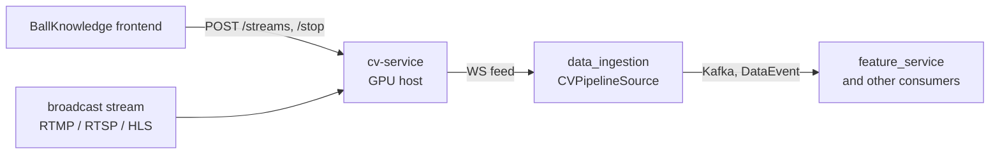
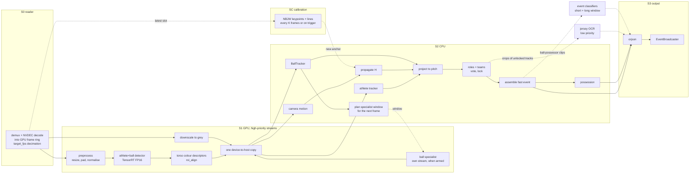

# cv-service: target production architecture

The cv-service as it will be when finished: one live pipeline, from a broadcast stream to
structured match events. This is the reference design, not a description of today's code. §12
lists what exists so far.

Sources: every design decision here is already recorded in one of these, and this doc gathers
them in one place. Where they disagree, this doc follows the newest decision.

| topic | source of the decision |
|---|---|
| live threads, runtime, budgets, roles, calibration, jersey, perf | `docs/path_b/plans/IMPLEMENTATION_PLAN.md` §0–§11 |
| ball: specialist, tracker, the 80% recall goal | `docs/plans/BALL_IMPROVEMENT_PLAN.md`, `BALL_TEMPORAL_ARCH.md` |
| latency work | `docs/path_b/plans/OPTIMIZATION_PLAN.md` |
| event taxonomy, revisions, payloads, Kafka | `PIPELINE_EVOLUTION.md` §1–§4 |
| API, lifecycle, WS, frame sources | `STREAMING_ARCHITECTURE.md` §1–§5 |
| product requirements | `REQUIREMENTS.md` |

Names are the final ones. "Path A" and "Path B" stop existing: there is one detector (the
2-class athlete/ball model) and one pipeline (implementation plan §12.2, step 9.4).

**How this doc is organised.**
- **Part I (§1–§12)** is the target architecture.
- **Part II (§13–§21)** is the research context: the dataset, the metric, the baselines, every
  measured result, what failed and why, candidate research gaps, and instructions for writing
  a proposal or literature review from this doc.

The doc is meant to be read without the rest of the repo. File paths are pointers for people
with the code; their content is summarised here.

---

## 1. What the service does

cv-service turns a **live football broadcast stream** (the only input) into **structured
events** for the rest of BallKnowledge. It is the only service that sees pixels. Everything
downstream gets typed events, never frames (FR-010).

Per frame, for every person on the pitch and for the ball:

- a stable **track ID**;
- a **pitch position** (0–1 along the length and width);
- a **role** (player, goalkeeper, referee, other) and, for players and goalkeepers, a **team**
  and a **jersey number**.

On top of that, it produces **match events**:

- rule-based: possession and turnover;
- classifier-based: pass, shot, clearance, carry, dribble, tackle, touch, interception, duel.

### Boundaries



- **cv-service** owns video to events. It never talks to Kafka.
- **`data_ingestion`** (a separate repo) owns Kafka. Its `CVPipelineSource` is an HTTP + WS
  client of cv-service: it registers the stream, consumes the feed, turns messages into
  `DataEvent`s and publishes them.
- **Deployment:** one cv-service process on one **RTX 30-series** GPU host (the RTX 3060 is
  the planning floor). One active stream at a time in v1.

---

## 2. Design rules

These apply to every stage (implementation plan §0):

1. **Only the minimum is on the critical path.** A fast event needs detection, tracking, a
   homography and role/team labels. Full calibration, OCR and the event classifiers run beside
   it or behind it.
2. **Frames stay on the GPU.** NVDEC decode, preprocessing and inference never copy a full
   frame to the host. Each frame makes one small device-to-host copy (boxes, colour
   descriptors, a small grey frame).
3. **Arrays on the live path, not pandas.** Per-frame data is `FrameDetections` (§4.2).
   DataFrames exist only in the batch and evaluation path.
4. **Allocate once:** a fixed GPU frame ring, fixed engine buffers and pinned host buffers.
5. **Stages overlap across frames,** so throughput is set by the slowest stage, not the sum.
6. **Skip work that can't change the answer:** propagate the homography between NBJW runs,
   OCR only unlocked readable tracks, run the ball specialist only when the main detector
   misses.
7. **The fast path owns the GPU,** through high-priority CUDA streams. Background work yields.
8. **The newest frame wins.** When behind, drop stale frames and count the drops; never queue
   latency.
9. **Measure everything and gate accuracy.** Each change is A/B tested in the perf log. A
   change that alters numerics (FP16, propagation, GPU descriptors) passes an accuracy gate
   first.
10. **Settings are chosen on the `select` split and frozen for `test`.** Thresholds and tuned
    parameters are never re-tuned on the data that scores them.

---

## 3. Live pipeline

### 3.1 Threads and data flow



| thread | does | never does |
|---|---|---|
| **S0 reader** | decodes on NVDEC (separate from the compute units) into a free ring slot; publishes "latest slot" | wait for the pipeline |
| **S1 GPU** | everything that reads the full frame; one small copy to the host | block on the CPU stages |
| **SC calibration** | full NBJW every K frames or on a trigger; its result arrives a few frames late and S2 re-anchors | sit on the critical path |
| **S2 CPU** | camera motion, tracking, ball tracking, projection, roles, window planning, possession, event assembly | touch a full frame |
| **S3 output** | serialises and hands messages to the WS broadcaster | delay S1 or S2 |
| **workers** | jersey OCR and the event classifiers, on low-priority streams | hold a frame-ring slot (they get copied crops) |

Stages hand off through **one-slot "latest wins" slots**, not queues. An overwritten item is
counted as a drop. If GIL contention ever limits S2, it moves to its own process with shared
memory; that is a measured escalation, not the default (implementation plan §1.2).

### 3.2 Latency budget

Targets on the RTX 3060 floor (implementation plan §1.4):

| stage | resource | target |
|---|---|---|
| decode 1080p | NVDEC | ≤ 3 ms |
| preprocess | GPU | ≤ 1 ms |
| detector at 1280×736, FP16, including NMS | GPU | ≤ 12 ms |
| descriptors + downscale + copy | GPU | ≤ 1.5 ms |
| ball specialist (missed frames only, overlapped) | GPU, own stream | ≤ 5 ms |
| camera motion | CPU | ≤ 2 ms |
| track + ball + project + roles + window plan | CPU | ≤ 3 ms |
| serialise + enqueue | CPU | ≤ 1 ms |
| NBJW calibration, off the critical path | GPU, SC | ≤ 25 ms per run, every K frames |

**Headline targets:**
- `e2e.fast` p95 **≤ 25 ms**, with a hard ceiling of 40 ms;
- **25 fps sustained with zero drops** over a 30-minute soak;
- enough GPU headroom left for OCR and the classifiers.

### 3.3 Frame source and decoding

- **NVDEC** decode through `PyNvVideoCodec`, handed to torch through DLPack without a copy. For
  network streams with no native support, PyAV demuxes on the CPU (cheap) and NVDEC still
  decodes.
- **Reconnects:** `LiveBroadcastFrameSource`'s logic is wrapped, not rewritten. It retries with
  exponential backoff (1 s, doubling, capped at 30 s, 5 attempts). After the last attempt it
  sets `disconnect_reason`, which separates a dropped stream from a finished file.
- **`target_fps` decimation** (default 25). A 50p broadcast processes every second frame,
  deterministically, so the trackers' motion models see even gaps.
- **Validation before acceptance** (FR-002), in order: reachable (`unreachable`), decodes a
  frame (`undecodable`), not black or frozen (`no_usable_video`). The thresholds still need
  tuning on real broadcast footage.
- **CPU fallback:** with no CUDA, OpenCV/FFmpeg decodes into host memory and the whole pipeline
  runs on the host. This is degraded mode, not real-time.

---

## 4. Stages

### 4.1 Model runtime

Every network (detector, ball specialist, both NBJW models, later the classifiers) runs through
`gsr_pipeline/runtime/`, never through Ultralytics at runtime.

| priority | backend | selected when |
|---|---|---|
| 1 | TensorRT FP16 | TensorRT importable, a CUDA device, the engine sidecar matches the GPU, TensorRT version and ONNX checksum, warm-up succeeds |
| 2 | ONNX Runtime GPU | the CUDA provider is actually active on the session |
| 3 | ONNX Runtime CPU | always (degraded mode) |

- **What ships:** the ONNX file plus a JSON sidecar (classes, input size, output layout,
  checksum, thresholds).
- **Engine builds:** the TensorRT engine is GPU-specific. The service builds it beside the ONNX
  on first start (`ensure_engine`): temporary files, a rename when done, and a `.building` lock.
  A mismatched engine is refused and never overwritten automatically.
- **Fallback:** at load time, walk the tiers and log why each was rejected. At runtime (OOM,
  lost device), drop one tier once, log at ERROR and report it in `/health`. Never flip back.
- **Verify, don't assume:** read the providers off the live session. The active backend of each
  model goes in `/health` and the perf log header.
- **CUDA graphs** for preprocess + engine + post-process are a measured optimisation.

### 4.2 Per-frame data: `FrameDetections`

A dataclass of preallocated numpy arrays, built in S2:

| group | fields |
|---|---|
| athletes | `boxes (N,4)`, `conf`, `track_id`, `pitch_xy` (NaN = unprojected), `descriptor (N,3)`, `role`, `team`, `role_provisional`, `role_locked`, `jersey` |
| ball | at most one row: `xy`, `conf`, `source` (main / specialist / predicted), `pitch_xy`, `track_id`, `frames_since_seen`, `state` |
| calibration | `H (3,3)`, `h_source` (fresh / propagated / reused), `h_age_frames` |
| timing | `frame_idx`, `timestamp_ms`, perf record handle |

`to_dataframe()` produces the batch column names, so the batch stages and evaluators reuse the
same code. AGENTS.md Rule 1 splits accordingly: arrays live, DataFrames in batch.

### 4.3 Athlete and ball detection

- **Model:** YOLO26s, 2 classes (`athlete`, `ball`), at **1280×736** (W×H, 16:9 at stride 32,
  strides 8/16/32). The head is not end-to-end, so NMS is required.
- **Preprocess on the GPU** straight from the ring slot: BGR to RGB, resize to 1280×720, pad
  to 736 with 114/255, normalise, written in place into the engine input.
- **Post-process on the GPU**, the same code for all three tiers: split boxes and scores,
  convert to corner form, per-class thresholds (`athlete_conf` 0.25, `ball_conf` 0.15),
  class-aware NMS (IoU 0.7, `max_det` 300, from the sidecar), map back to frame pixels.
- **Live batch size 1;** the batch path may use a batch-8 profile.
- **Parity gate:** each tier within 1 point of the Ultralytics `.pt` on ball recall and
  precision and on people recall, on at least 3 sequences.
- **Possible retrain** (ball plan item 4, decided after the diagnosis): more data or a higher
  resolution for small balls. Anything that changes the input size or classes re-runs the
  parity gate and every ball gate.

### 4.4 Ball: detector, specialist, tracker

The ball is too small and fast for box-overlap tracking, so it has its own path. **Goal: ball
recall above 80%** on the 15 held-out test sequences, with precision no worse than today
(ball plan §0).

```
main detector balls ─┐
                     ├─► BallTracker ─► one ball per frame (source, state, frames_since_seen)
specialist point ────┘        │
                              └─► window for the specialist at t+1 (predicted position)
```

1. **Main detector:** ball candidates at ≥ 0.15 (lower-confidence candidates are passed on as
   well when the tracker's gating uses them).
2. **Temporal specialist** (`c5c` today, `c5d` if it passes its gates). It runs only when the
   tracker has no confident main-detector ball. Input: a **640×640 native-resolution window**
   from frames t−2, t−1 and t, centred on the tracker's **predicted** position (camera-motion
   compensated). The model is 5 channels internally: RGB of t plus two difference images.
   Output: one point plus a confidence. Threshold from the sidecar (0.70 for `c5c`), chosen on
   `select`. It runs on its own high-priority CUDA stream, so on the GPU it overlaps the main
   detector.
3. **`BallTracker`:** a constant-velocity Kalman filter in pixel space. Each frame it is shifted
   by the camera-motion affine. Candidates are gated by a radius that grows with the gap
   (`r = a + b·gap`), then ranked by distance and confidence (the main detector wins ties).
   Without a match it **coasts** on the prediction for a bounded number of frames, then
   restarts on the next confident sighting. Output: one ball with a persistent `track_id`,
   `source`, `state` and `frames_since_seen`.
4. **Spare balls:** the gating is what picks the match ball when a window holds a second one.

Live, the tracker is causal: it only looks back. The batch path also runs a dynamic-programming
best path over all candidates, plus interpolation across short gaps (ball plan §3.5). Every
tracker setting comes from `tracker_config.json`, chosen on `select`.

### 4.5 Camera motion and athlete tracking

- **One camera-motion estimate, used everywhere.** S1 sends a small grey frame (480×270).
  S2 tracks sparse Lucas–Kanade features with athlete boxes masked out, and fits a RANSAC
  homography `M(t−1→t)`. It feeds the athlete tracker, homography propagation, the
  `BallTracker` and the specialist window.
- **Scene cuts** show up as a low inlier ratio or a large frame difference. A cut resets the
  trackers' motion, triggers NBJW and marks the frame as not a pitch view.
- **Athlete tracker:** ByteTrack, or BoT-SORT with camera-motion compensation fed from this
  estimate (ReID off). The choice is measured on AssA/IDF1 and ms per frame (implementation
  plan §6.2). Either way, it uses the tracker's own detection index and takes numpy arrays as
  input.

### 4.6 Calibration, off the critical path

- **NBJW** (two HRNets: keypoints and lines) on TensorRT FP16, with the fast heatmap decode.
  The vendored `nbjw_calib` package is not edited; only its forward calls are replaced.
- **Propagate, then re-anchor:** the fast path uses `H_t = H_anchor · M(anchor→t)⁻¹`. SC runs
  full NBJW every `calib_every_k` frames (5 today, to be confirmed on several sequences).
  It also runs at once on a scene cut, few motion inliers, a broken motion chain, a zoom change
  over 15%, or an anchor that is too old. Event triggers are rate-limited to one run per 3
  frames. A late result re-anchors and re-applies the motion since that frame.
- **Projection:** a vectorised perspective transform. Athletes use the bottom centre of the box,
  the ball the box centre. **Implausible projections are dropped:** athletes beyond the margin
  become `other`, and the ball's pitch position is nulled.
- **On the wire:** pitch coordinates in **0–1**: `x = (x_m + 52.5) / 105`,
  `y = (y_m + 34) / 68`. Every frame also carries `h_source` and `h_age_frames`.
- **Known limit:** the pitch template is fixed at 105×68. The long-term fix builds it from the
  match's `length_m`/`width_m`, passed in `POST /streams` (`PIPELINE_EVOLUTION.md` §7.12).

### 4.7 Roles and teams, live

The detector says only "athlete". A per-match, unsupervised kit-colour classifier recovers
role and team (implementation plan §4.2):

1. **Descriptors on the GPU:** `roi_align` takes every torso patch at 16×16. A grass mask,
   then Lab (on OpenCV's 8-bit scale), then a masked median gives `(N,3)` per frame. Gate:
   within 0.5 points of the CPU descriptors on role and team accuracy.
2. **Provisional fit from the first pitch-view frame,** with `role_provisional: true`. It
   refits on the growing window at gated frames 1, 5, 25 and 50. No publish delay.
3. **Refits off the hot path:** a background thread refits every 120 s on a bounded reservoir
   (~5,000 samples) and swaps the centres in atomically.
4. **Stable identity across refits:** new team centres are matched to old ones, so team A never
   silently swaps with team B.
5. **Vote and lock per track:** a confidence-weighted vote. The running winner is emitted, and
   the track locks after `lock_min_votes` with a margin. Locked tracks skip prediction.
6. **Role from colour plus position:** a team kit is a player; a minor colour near a goal is a
   goalkeeper; other minor colours are referees; off the pitch is `other`.
7. **Half-time flip** is detected from which end each team defends (mean pitch x over a
   sliding window, with hysteresis), and every flip is logged.
8. **Seeding (optional):** kit colours from match setup would remove the team cold start.

### 4.8 Jersey numbers

- A `JerseyRecognizer` interface; EasyOCR is today's implementation and is expected to change.
- **Recognition only:** the crops are already torsos, so EasyOCR's text detector is skipped.
  Digits only.
- **Crops from the GPU** (64×128 `roi_align`). Only throttled tracks are copied to the host:
  players and goalkeepers that aren't jersey-locked, whose box is tall enough, and that weren't
  tried in the last `ocr_interval_frames`.
- **Runs on a low-priority stream** in `AppearanceWorkerPool`, which replaces
  `ReidWorkerPool`. ReID leaves the live path.
- **Number per track** by summed confidence; `PLAYER_IDENTIFIED` fires on first confirmation
  or on change.

### 4.9 Possession and turnover, live

- The rule-based logic of `possession.py` runs **incrementally in S2** on the tracked ball.
  It uses a proximity ellipse (3.0 m along the length, 1.5 m across) and a 20-frame hold
  before the ball counts as loose.
- `TURNOVER` fires when possession changes team.
- **Open decisions** (`PIPELINE_EVOLUTION.md` §7.2–7.3): emit `POSSESSION` on change rather
  than every frame (likely), and whether `TURNOVER` is emitted here or derived in
  `feature_service`.

### 4.10 Event classifiers

Actions that need motion context: `PASS`, `SHOT`, `CLEARANCE`, `CARRY`, `DRIBBLE`, `TACKLE`,
`TOUCH`, `INTERCEPTION` and `DUEL` (`PIPELINE_EVOLUTION.md` §3.2).

- **Input:** short clips cropped around the ball possessor, from the frame ring, on workers.
  They never block the fast path.
- **Two windows in parallel:**
  - a **short window** (~0.5–1 s) gives a fast first answer;
  - a **long window** (~2–3 s) revises it with more context.
  - Exact frame counts are set from real clips.
- **`TOUCH`** gets its own small model over ~3–5 stacked frames. Contact lasts about 10 ms,
  so the evidence is the ball changing direction between frames.
- **Revisions** follow §5.3. No classifier event ships before that protocol is implemented.
- **Before building:** a geometric baseline (trajectory + possession) sets the bar the
  classifier must beat. The training labels most likely come from aligning StatsBomb events to
  video (`PIPELINE_EVOLUTION.md` §7.4–7.5).
- **Later milestones, same infrastructure:** restarts (ball out of play from tracking, restart
  type from a whole-frame classifier), referee-crop events (fouls, cards), and scoreboard OCR
  for match clock and score (FR-008, FR-009).

---

## 5. Output contract

### 5.1 WS messages

S3 builds messages straight from the arrays with `orjson`. Each WS message is one JSON
object:

| message | when | carries |
|---|---|---|
| `fast` | every frame | `frame_idx`, `timestamp_ms`, `is_pitch_view`, `h_source`, `h_age_frames`, and per athlete `track_id`, `role`, `team`, `team_label`, `role_provisional`, `role_locked`, `bbox_ltwh`, `pitch_x`, `pitch_y`; the ball with `source`, `state`, `frames_since_seen` |
| `appearance` | when an OCR job finishes | `track_id`, `jersey_number`, confidence |
| `possession` | on change | possessor `track_id`, team, frame |
| `event` | classifier output and its revisions | §5.2–§5.3 |

**Roles on the wire:** `player`, `goalkeeper`, `referee`, `other`, `unclassified` (before the
first pitch view) and `ball`. Team moves from appearance messages to fast messages.
`CVPipelineSource` maps every role to exactly one event type and skips `other` and
`unclassified` explicitly (it never falls through to another type).

### 5.2 Events downstream

`CVPipelineSource` turns messages into `DataEvent`s (`PIPELINE_EVOLUTION.md` §3.5, §4):

| group (Kafka) | event types |
|---|---|
| `positional` | `PLAYER_POSITION`, `BALL_POSITION`, `REFEREE_POSITION`, `PLAYER_IDENTIFIED` |
| `ball` | `POSSESSION`, `TURNOVER`, `PASS`, `SHOT`, `CLEARANCE`, `CARRY`, `DRIBBLE`, `TACKLE`, `TOUCH`, `INTERCEPTION`, `DUEL` |

- **People in events:** every person is an `actor`:
  `{track_id, team_side, jersey_number, player_id}`. `player_id` stays null until identity
  resolution maps jersey and team to the coach's lineup.
- **Fields on every on-ball event:** `actor`, `location {x, y}`, `frame_idx`, `timestamp_ms`
  (frame time), `confidence`, `window` and the revision keys.
- **Per-type payloads** follow the table in `PIPELINE_EVOLUTION.md` §3.5. `SHOT` is one type
  with an `outcome` (StatsBomb's values).
- **`timestamp_ms` is not monotonic across event types,** because appearance and classifier
  results arrive late. Consumers joining on time must not assume order.

### 5.3 Revisions

From `PIPELINE_EVOLUTION.md` §3.4. The keys sit in `DataEvent.metadata`:

| key | meaning |
|---|---|
| `event_uid` | `{source_id}:{anchor_frame_idx}:{anchor_track_id}`, one per moment, whatever the type |
| `revision` | 0 at first, +1 per revision |
| `final` | true on the last revision ever sent |
| `status` | `active` or `retracted` |
| `related_event_uid` | only on related events, such as an `INTERCEPTION` explaining a `TURNOVER` |

**Rules:**
- Per `event_uid`, the highest revision wins. A repeated `(event_uid, revision)` is a
  duplicate and is ignored, so consumers stay idempotent under at-least-once delivery.
- A revision may change the type (`SHOT` to `PASS`) but never the Kafka group.
- Rule-based events are never revised and carry no revision keys.
- Consumers with irreversible side effects act only on `final`.

---

## 6. API and stream lifecycle

FastAPI (`STREAMING_ARCHITECTURE.md` §2–§4):

| endpoint | does | answers |
|---|---|---|
| `POST /streams` | `{source_type: rtmp\|rtsp\|hls\|file, source_url}`: validates synchronously, then starts the pipeline | `201 {stream_id, state}`; `409` already active; `422` malformed, undecodable or no usable video; `424` unreachable |
| `POST /streams/{id}/stop` | stops and releases everything | `200`; `404` if that stream isn't active (including no stream at all) |
| `GET /streams/{id}/events` | WS feed, one consumer | close codes `4401` bad key, `4404` no such stream, `4409` already attached; `1000` at the end |
| `GET /streams/{id}/metrics` | rolling per-stage latency, fps, drops | — |
| `GET /health` | readiness, stream state, active backend per model, any runtime fallback | — |

- **Auth:** a static `X-CV-Service-Key` header from `CV_SERVICE_API_KEY`. The WS takes it as
  `?api_key=`. Auth fails closed if the variable is unset.
- **`file`** sources are for development and staging only.
- **Lifecycle:** `IDLE → VALIDATING → STREAMING → STOPPING → IDLE`. A failed validation goes
  straight back to IDLE. A source that drops for good also goes to STOPPING.
- **WS delivery:**
  - a bounded queue (100) that drops the oldest message and never blocks the pipeline;
  - no replay;
  - the pipeline keeps running if the WS client goes away.
- **The known cost:** events lost between cv-service and `data_ingestion` are lost before
  Kafka, so at-least-once starts at `data_ingestion`.
- **`CVPipelineSource` reconnects** to the same `stream_id` with backoff. When it gives up it
  emits `SOURCE_DISCONNECTED` and leaves stopping the stream to the caller.

---

## 7. Batch path

`process_sequence` uses **the same runners, models and code** as the live path. It exists for
evaluation and offline runs, and writes SoccerNet GSR `predictions.json`, a protected format.

| | live | batch |
|---|---|---|
| detector engine | batch 1 | may use batch 8 |
| calibration | propagated, every K | per-frame NBJW (the reference), or every K to measure propagation |
| roles | provisional fit, running vote | fit on gated frames (whole sequence or first N), vote per tracklet in `tracklet_agg` |
| ball | causal `BallTracker` | plus the best path and interpolation (§4.4) |
| refinement | none | `refine.py`: split, merge (ReID) and interpolate |

The bridge between the two is `FrameDetections.to_dataframe()`.

---

## 8. Measurement

### 8.1 Perf recording

From implementation plan §10.

- **Per frame:** each stage's duration and start offset, so overlap and the critical path are
  visible. Stages are named `s0.*` to `s3.*` and `sc.nbjw`, with handoff waits and
  **`e2e.fast`**, the headline: decode done to fast event enqueued.
  - GPU stages are timed with CUDA events, read later by the writer thread, with no sync on the
    hot path.
  - CPU stages use `perf_counter_ns`.
- **Also per frame:** counts, `h_source`, refit in progress, drops at every handoff and queue.
- **1 Hz device sample** through NVML: utilisation, memory, NVDEC, clocks, power, temperature
  and throttle reasons. Throttling shows up as p99 drift in long runs.
- **Startup, once:** load, engine deserialise, graph capture, warm-up, first inference.
- **Where it goes:** JSONL per stream. A background writer never blocks: it drops and counts.
  The header records the commit, config, GPU, versions and backend per model.
- **Reading it:** a rolling summary goes in the logs and `/metrics`. `perf_report.py` gives
  percentiles, the critical path and A/B comparisons. Every phase adds an entry to the perf
  log.
- **Debugging:** NVTX ranges for Nsight Systems, and `py-spy --gil` for CPU contention. The
  recorder's own overhead must stay under 0.1 ms per frame.
- **Runtime hygiene:** `gc.freeze()` after startup, pinned buffers, `cudnn.benchmark`.

### 8.2 Observability

The product owner's rule (`REQUIREMENTS.md` §4): **no per-frame log lines.**

- **Aggregates:** the rolling summary every N frames.
- **Anomalies:** backend fallbacks, frame drops, NBJW failure streaks, team flips, refits that
  matched badly, WS drops, reconnects.
- Metrics, spans and alert thresholds still need designing.

### 8.3 Accuracy gates

| gate | measures | on |
|---|---|---|
| detector parity | each runtime tier against the `.pt` | ≥ 3 sequences |
| ball system | recall and precision of the fused ball, longest gap | 15 test sequences, settings from `select` |
| calibration | pitch error of propagation and of FP16, in metres | GSR `valid` |
| roles | role and team accuracy, GPU vs CPU descriptors, fit-window table | ≥ 4 sequences |
| tracking | AssA, IDF1 | GSR `valid` |
| end to end | GS-HOTA (batch) | 15 test sequences |
| live soak | `e2e.fast` p95, fps, drops, memory, p99 drift | 30 minutes |

---

## 9. Code layout

```
api/                      main.py, stream_manager.py, auth.py, schemas.py, event_broadcaster.py
gsr_pipeline/
  live/                   pipeline.py (stage threads), frame_ring.py, nvdec_source.py,
                          detections.py (FrameDetections), serialize.py, athlete_roles_live.py,
                          ball_crop.py
  runtime/                backend.py (tiers, sidecars), trt_runner.py, ort_runner.py, postprocess.py
  detect.py               AthleteBallDetector
  ball_specialist.py      temporal specialist runner
  ball_tracker.py         BallTracker (live) and best path (batch)
  camera_motion.py, calibration_live.py, nbjw_calib/ (vendored), nbjw_fast_decode.py
  athlete_roles.py        kit-colour classifier
  track.py, jersey.py, possession.py, perf.py
  pipeline.py             batch process_sequence
  tracklet_agg.py, refine.py, output.py, evaluate*.py
models/                   athlete_ball/, ball_specialist/, calibration/: ONNX plus sidecars
scripts/                  export, engine build, perf_report, evaluation, training
```

Renames from today (implementation plan §12.2, step 9.4):
- `detect_athlete.py` becomes `detect.py`;
- `runs/yolo26s_athlete_ball/` becomes `models/athlete_ball/`;
- `docs/path_b/` becomes `docs/pipeline/`.

---

## 10. Dependencies

- **Runtime:** `onnxruntime-gpu`, `tensorrt`, `PyNvVideoCodec`, `orjson`, `pynvml`, torch +
  torchvision, OpenCV, EasyOCR (until replaced), FastAPI + uvicorn.
- **CPU-only hosts:** `onnxruntime` instead, without the GPU packages.
- **Export and parity reference only:** `ultralytics>=8.4.0`. ReID (torchreid) only for batch
  refinement.

---

## 11. Open decisions

Recorded in the sources, not settled yet:

| # | question | where |
|---|---|---|
| 1 | ByteTrack or BoT-SORT with injected camera motion | impl. plan §6.2 |
| 2 | `calib_every_k` on several sequences, and the FP16 projection gate | impl. plan §7 |
| 3 | Detector retrain for the ball (data, resolution) | ball plan §5, after the diagnosis |
| 4 | `POSSESSION` on change vs every frame; who emits `TURNOVER` | `PIPELINE_EVOLUTION.md` §7.2–7.3 |
| 5 | Classifier window sizes, model, training labels, geometric baseline first | `PIPELINE_EVOLUTION.md` §2, §7.4–7.6 |
| 6 | How consumers reconcile per-frame and per-window events | `REQUIREMENTS.md` §4 |
| 7 | Jersey model to replace EasyOCR | impl. plan §8 |
| 8 | Player identity: jersey + team to the lineup's `player_id` | `PIPELINE_EVOLUTION.md` §7.9–7.10 |
| 9 | Pitch template from the match's real dimensions | `PIPELINE_EVOLUTION.md` §7.12 |
| 10 | Validation thresholds and role defaults tuned on real broadcasts | `STREAMING_ARCHITECTURE.md` §7 |
| 11 | The exact RTX 30-series card | impl. plan §16 |
| 12 | Match clock: mapping stream time to match time | `PIPELINE_EVOLUTION.md` §7.8 |

---

## 12. Where the code is today (2026-10-25)

| area | today | target |
|---|---|---|
| detector | 2-class ONNX through `runtime/` with tier fallback; TensorRT engine for the detector not yet measured | same, TensorRT FP16 verified |
| ball | `c5c` plus `BallFuser` (window at the last sighting) inline after the detector; ~69.5% recall | `BallTracker` + specialist on its own stream; > 80% |
| roles and teams | `live_roles.py`: buffer 250 frames, fit once, running vote | provisional fit from frame 1, refits, lock, half-time flip, GPU descriptors |
| live pipeline | `process_stream` on one thread, DataFrames | S0–S3 threads, NVDEC, frame ring, `FrameDetections` |
| calibration | `LiveCalibrator`, K = 5, inline or async | same, gated on several sequences; implausible projections dropped |
| jersey | EasyOCR with its text detector, on a worker pool | recognition only, GPU crops, throttled |
| possession | batch only | live, in S2 |
| event classifiers | none | short + long window with revisions |
| perf | timers in the eval notebook | `perf.py`, JSONL, `/metrics`, `perf_report.py` |
| wire | `fast` (with team and ball source) / `appearance`, positions in metres, no `h_source`, lock or provisional flags | §5.1 |

---
---

# Part II: research context

## 13. The product and its constraints

- **BallKnowledge** is a web application for football coaches, managers and assistants. It
  gives live tactical analysis during a match. The analytics services (`feature_service`:
  formations, pressing, transitions, set pieces) consume cv-service's events.
- **The one input is the public broadcast feed.** There are no tracking cameras, no GPS vests
  and no manual tagging. This is the central constraint, and the reason most professional
  tracking setups don't apply:
  - one moving, zooming, cutting camera;
  - replays, close-ups and graphics overlays;
  - players and the ball leave the frame.
- **Live, not offline.** Events must arrive within tens of milliseconds of the frame. Batch
  methods that look at the whole clip (future frames, global clustering, tracklet merging) are
  available only in the offline evaluation path.
- **Hardware:**
  - **Deployment:** one consumer GPU (RTX 30-series, planned against an RTX 3060).
  - **Training:** an RTX 3090 and Kaggle (2× Tesla T4, 12 h sessions).
  - **Development:** the dev laptop has no NVIDIA GPU.
- **Per-match, label-free adaptation.** Nothing about the teams is known in advance (kits,
  players), so role and team assignment is fitted unsupervised per match.

## 14. Dataset and splits

**SoccerNet Game State Reconstruction (GSR), `gamestate-2024`:**
- clips are 30 s long, 1920×1080, 25 fps, 750 frames each;
- labels per frame: boxes for every person and the ball, track IDs, role (player / goalkeeper /
  referee / other), team (left/right), jersey number, and the pitch position;
- labels per clip: pitch calibration;
- GSR splits: `train` (57 clips), `valid` (58) and `test` (49, labels included).

The project's own split, by clip:

| split | clips | from | used for |
|---|---|---|---|
| `train` | 57 | GSR `train` | training the main detector and the ball specialist |
| `pool` | 82 | 33 GSR `valid` + 49 GSR `test` clips | specialist training, the only source of hard examples |
| `select` | 10 | GSR `valid` | choosing epochs, thresholds and tracker settings |
| `test` | 15 | GSR `valid`: 021 022 023 026 030 033 036 040 044 047 050 054 080 086 090 | final gates only, never tuned on |

**Known label issues:**
- spare balls by the advertising boards are unlabelled, so some "false positives" are real
  balls;
- ball boxes are loose, so the ball is scored by its centre;
- some labelled balls are fully hidden behind players.

**Related SoccerNet data** (not used yet):
- SoccerNet-v2 action spotting: one timestamp per action, on 550 full games;
- broadcast video at 224p/720p, which needs an NDA password.

**Overlap with StatsBomb:** StatsBomb open data has player-attributed events (pass, shot,
carry, dribble, duel, with location and outcome). Matching by date and team names finds about
**133 games in both** StatsBomb and SoccerNet-v2. That is the most plausible source of action
labels (§4.10). The clock alignment between the two has not been attempted.

## 15. Metrics

- **GS-HOTA** (SoccerNet GSR's official metric), implemented in `gsr_pipeline/evaluate.py`:
  - **LocSim:** a Gaussian on pitch distance, `exp(ln(0.05)·d²/τ²)` with τ = 5 m.
  - **IdSim:** 1 only if role, team and jersey all match.
  - Predictions are Hungarian-matched to ground truth at 19 thresholds. Detection accuracy
    (DetA) and association accuracy (AssA) combine into GS-HOTA.
  - It scores **batch output only**. There is no standard metric for a causal, live
    reconstruction (a gap, §20).
- **Ball:**
  - **frame recall:** of the frames with a labelled ball, the share where the system's one ball
    point is within **15 px** of it;
  - **precision:** of the system's ball outputs, the share on a labelled ball;
  - **longest miss:** the longest run of missed frames per clip.
- **Detection:** people are matched at IoU ≥ 0.5, class-agnostic.
- **Roles and teams:** accuracy on ground-truth boxes (isolates the classifier) and end to end
  (real detector and calibration).
- **Calibration:** pitch position error in metres, against ground truth and against per-frame
  NBJW.
- **Latency:**
  - per-stage ms (mean, p50, p95), measured end to end per frame;
  - sustained fps;
  - frame drops.

## 16. Prior methods this system builds on

These are the methods the system uses or compares against. The repo holds no citations, so a
proposal must look up and verify each reference.

| component | method used | alternatives / official baseline |
|---|---|---|
| GSR baseline | the official `sn-gamestate` baseline (TrackLab) | — |
| detection | YOLO26s, 2 classes (athlete, ball), trained at imgsz 1280 | baseline: YOLOv8m / YOLO11m, 4 classes |
| person tracking | ByteTrack | BoT-SORT with camera-motion compensation; baseline StrongSORT |
| re-identification | OSNet x0.25 (batch refinement only) | PRTReId, BPBReID |
| calibration | NBJW ("No Bells, Just Whistles"): HRNet keypoint and line heatmaps → homography | TVCalib |
| jersey numbers | EasyOCR | MMOCR (baseline) |
| roles and teams | unsupervised kit-colour clustering (Lab, per match) plus pitch position | KMeans on appearance/ReID features (baseline style) |
| ball specialist | ResNet-18 U-Net, CenterNet-style heatmap + offset, focal loss, on 3 frames | small-object and tracking-by-heatmap models (TrackNet family for tennis/badminton) |
| ball tracking | constant-velocity Kalman filter with camera-motion compensation; dynamic-programming best path offline | — |
| runtime | ONNX → TensorRT FP16, ONNX Runtime fallback | — |

## 17. Measured results

All numbers are measured, with the conditions given. Don't compare rows with different data.

### 17.1 Detector

On SNGS-021, every frame on CPU. The ball is open play only: the kickoff (frames 0–167) is
missed by every model.

| model @ inference size | people R / P | ball R / P (conf 0.15) | longest ball gap |
|---|---|---|---|
| YOLOv8n 4-class @640 (old) | 94.7% / 94.5% | 67% / 79% | 31 frames |
| same, run at 1280 without retraining | 93.6% / 85.0% | 49% / 77% | 51 |
| YOLO26n 4-class @640 | 95.3% / 95.3% | 56% / 71% | 18 |
| YOLO26n-P2 4-class @640 | 95.4% / 95.2% | 67% / 63% | 21 |
| YOLO26s 2-class @640 | 96.0% / 95.9% | 65% / 75% | 20 |
| **YOLO26s 2-class @1280 (current)** | **97.0% / 95.5%** | **79% / 71%** | 22 |

**What it showed:**
- **The gain comes from training resolution, not model capacity.** Inferring at a higher size
  without retraining hurts. Training at 1280 gives about +10 points.
- **On the whole 15-clip test set,** the main detector's ball recall is **59.4%** (precision
  85.3%). On its own training clips it is 84.3%, so it generalises poorly to new footage.
- **The ball is small for the detector.**
  - Frames are scaled from 1920×1080 to 1280×720.
  - A 10–20 px ball becomes 7–13 px, on a stride-8 grid with no stride-4 head.
  - Recall by ball size (T4 run): 10–20 px **56.4%** (n=275); ≥ 20 px **100%** (n=25).

### 17.2 Ball specialist (`c5c`)

**The model:**
- **Input:** a 640×640 native-resolution window from frames t−2, t−1 and t. Five channels:
  RGB of t, then grey(t)−grey(t−1) and grey(t−1)−grey(t−2).
- **Network:** a ResNet-18 encoder (ImageNet weights, first layer widened to 5 channels) with a
  U-Net decoder. It predicts a 320×320 heatmap plus a sub-pixel offset.
- **Size:** 14.5 M parameters, about 8 ms per call (PyTorch FP16, RTX 3090).
- **Training:**
  - CenterNet focal loss plus an L1 offset loss;
  - hard frames (the main detector missed) weighted ×3;
  - motion-blur augmentation on 25% of samples;
  - 30 epochs, 7.5 h on an RTX 3090;
  - 67k samples built (51.9k used).
- **Threshold:** 0.70. The rule: the lowest threshold at which ≥ 90% of its guesses on
  `select` are on the ball.

On the 15 test clips:

| | ball recall | precision | longest miss (mean / max) |
|---|---|---|---|
| main detector alone | 59.4% | 85.3% | 2.9 s / 9.9 s |
| + `c5c` (simulated) | **69.5% (+10.1)** | **86.5% (+1.2)** | 2.7 s / 9.9 s |
| main alone, live runtime at 1280×736 (4 local test clips) | 56.8% | 88.2% | — |
| + `c5c`, live runtime (same 4 clips) | 64.3% | 88.5% | — |

**What it showed:**
- **On crops:**
  - it finds 54.5% of the balls the main detector missed;
  - it keeps 96.9% of the easy ones;
  - 94.4% of its outputs are on the labelled ball, more than the main detector's 85%. That is
    why precision rises.
- **It only catches the ball straight after a miss.** Its recall by frames since the last
  sighting:

  | frames since last sighting | 1 | 2 | 3–5 | 6–10 | 11–15 |
  |---|---|---|---|---|---|
  | recall | 66% | 18% | 9% | 4% | 1% |

  After two consecutive misses, nothing recovers the ball. That gap motivates the tracker and
  `c5d` (predicted window centres, training on later gaps).
- **The gate passed with no margin:** the +10.1-point gain cleared its +10 requirement by
  0.1 points.

**Earlier attempts on the same 15 clips:**

| attempt | recall change | precision change |
|---|---|---|
| v1, a single-frame YOLO26s on 640 crops | +4.7 (best) | −6.2 (failed its gate in 7 settings) |
| `c5b`, the same design on 90 training clips | +9.2 | +1.2 |
| `c5c`, + 49 more clips and motion blur | +10.1 | +1.2 |

### 17.3 Roles and teams (unsupervised kit colour)

| measurement | role acc. | team acc. | referee recall |
|---|---|---|---|
| SNGS-021, GT boxes, fit on 250 frames, scored on the other 500 | 95.3% | 97.6% | 74.3% |
| 3 `valid` clips, GT boxes (T4 run) | 95.5% | 98.2% | 81.8% |
| SNGS-021 end to end: real detector, real calibration | 98.4% | 98.8% | 88.1% |

End-to-end recall on SNGS-021 is 99.2% for players and 100% for goalkeepers.

**Where referees go wrong** (end to end): of 118 ground-truth referees, 8 are labelled
goalkeeper (standing near a goal) and 6 are labelled player (kit absorbed into a team's colour
cluster).

**A methodology lesson:** an early estimate of 67% end-to-end referee recall multiplied two
stage-isolated recalls together. That was wrong, because the errors are correlated. The real
end-to-end figure is 88.1%.

### 17.4 Calibration

- **Propagation** (NBJW every K = 5 frames, camera motion in between): on SNGS-021, pitch error
  vs ground truth is **0.58 m**, against 0.59 m with NBJW on every frame. Propagated positions
  are 0.18 m from per-frame NBJW. One clip only.
- **Speed on a T4:**
  - Calibration took 479.9 ms/frame before optimisation. Most of that was unused
    camera-parameter voting, not the networks.
  - After optimisation it is **37.5 ms mean** (p95 128.8 ms on frames that run NBJW).
  - The keypoint and line engines take 32.9 and 37.6 ms (TensorRT FP16).
  - A rewritten heatmap decode gives identical keypoints and is 7.6× faster on CPU.

### 17.5 End to end and latency

3 `valid` clips × 100 frames on a Kaggle T4, jersey ignored, no refinement:

| measure | value |
|---|---|
| athlete recall / precision | 97.9% / 94.7% |
| GS-HOTA, persons | **58.95%** (DetA 52.9, AssA 71.8) |
| GS-HOTA, with ball | 57.75% |
| latency, sequential, whole pipeline | 85.9 ms mean / 178.1 ms p95 (11.65 fps) |

Latency by stage:

| stage | mean ms | share |
|---|---|---|
| detector | 24.3 | 28% |
| calibration | 37.5 | 44% |
| frame load | 10.7 | 12% |
| tracker | 6.9 | 8% |
| descriptors + records | 5.2 | 6% |
| projection | 1.3 | 1% |

- **Not like for like:** the old 4-class pipeline's only GS-HOTA figure (30.72% on the full
  official test set, jersey counted, older code) can't be compared with these numbers.
- **The official baseline** scores 22.26% GS-HOTA. That is the authors' figure, not
  reproduced here.
- **The latency target** for the threaded live design is p95 ≤ 25 ms (§3.2). It is not built
  yet.

## 18. What failed, and what it taught

| attempt | result | lesson |
|---|---|---|
| running the detector at a higher size without retraining | ball recall 67% → 49% | resolution helps only when trained for |
| single-frame ball specialist on crops (v1) | good on crops, failed the system gate in 7 settings | one frame can't resolve blur or occlusion; train exactly as the runtime will call it |
| specialist epoch chosen on recall at one threshold | the score swung 16–41% between epochs | select on an area under recall vs false-positive rate |
| training on crops where the labelled ball is outside the runtime window | the most confident "false positives" were real spare balls | those crops were mislabelled; excluded |
| 9-channel input (3 raw frames) vs 5-channel (frame + 2 differences) | 5 channels better on hard crops (58.5% vs 52.1%) and 1.6× cheaper | ready-made motion images beat letting the network compare frames, at this data size |
| `channels_last` memory format | 4× slower training | measure, don't assume |
| over-splitting kit colour (`merge_dist` 15–20) | one kit split in sun and shade; ~180 players labelled referee | lighting variance must be merged explicitly |
| multiplying stage recalls to estimate end to end | 67% estimated vs 88.1% real | errors are correlated; measure end to end |
| more distinct training clips (`pool` 33 → 82) | the largest single gain for the specialist | clip diversity beats more samples from the same clips |

## 19. Work in progress (as of 2026-10-25)

- **Ball improvement toward 80%** (ball plan; a Kaggle notebook is built, not yet run):
  1. **Miss diagnosis:** tag each miss with a cause (small, blurred, occluded, out of window,
     unlabelled spare ball, …) and estimate the reachable ceiling.
  2. **Ball tracker** (§4.4), live and batch, tuned on `select`. Its gate T is on `test`.
  3. **`c5d`:** the specialist retrained with windows centred on the tracker's prediction and
     more weight on longer gaps.
  4. **Possible detector retrain:** data or resolution, decided from item 1.
- **Open question:** whether 80% must hold live (forward-only tracking) or only in batch
  (interpolation on both sides of a gap).

## 20. Candidate research gaps and novelty angles

These are **hypotheses that came out of this project's evidence**. A literature review must
confirm each one before a proposal claims it as a gap, because 2025–2026 papers may already
cover it.

1. **Live, causal game-state reconstruction from one broadcast camera.** GSR work and its
   metric are batch: whole-clip tracklet merging, global clustering, interpolation using
   future frames.
   - *Gap:* a reconstruction that is causal, real-time on a consumer GPU (≤ 25 ms p95), and
     a **metric for live GSR**: GS-HOTA restricted to causal output, plus latency and
     identity-stability terms.
   - *Evidence:* §3, §7, §15, and the batch-vs-live ball gap in §17.2.
2. **Small, fast ball detection in broadcast football.** The ball is 10–20 px. The detector
   finds 56% of balls under 20 px and 100% above, and recall collapses two frames after a
   miss.
   - *Angle:* a detector-plus-temporal-specialist pair, where a cheap multi-frame heatmap model
     runs only on missed frames, in a motion-predicted native-resolution window.
   - *Evidence:* +10.1 recall and +1.2 precision. The 5-channel difference input beat raw
     stacked frames.
   - *Compare with:* TrackNet-style ball tracking (tennis, badminton) and recent football
     ball-tracking papers.
3. **Ball tracking under broadcast camera motion.** The Kalman state is shifted each frame by
   a camera-motion estimate shared with calibration and person tracking. The gate radius grows
   with the gap. The match ball is told apart from spare balls.
   - *Gap to check:* most ball trackers assume a static camera.
4. **Role and team assignment without role labels.** A 2-class detector (athlete, ball) plus
   per-match unsupervised kit-colour clustering and pitch geometry.
   - *Results:* 98.4% role and 98.8% team accuracy end to end on one clip.
   - *Live issues:* a cold start with no publish delay, stable team identity across refits,
     and the half-time flip detected from play.
   - *Compare with:* supervised role classifiers and contrastive team-clustering papers.
5. **Calibration at video rate.** Homography propagation by camera motion between sparse
   NBJW runs, with re-anchoring triggers (scene cut, low inliers, zoom, age).
   - *Result:* 0.58 m vs 0.59 m error at 1/5 of the NBJW cost.
   - *Compare with:* recent temporal calibration papers.
6. **From tracking to events with no paired labels.** Weak supervision by aligning StatsBomb
   events to SoccerNet broadcast video (~133 overlapping games). Also: a geometric baseline,
   and short/long dual-window classifiers with revision semantics for live event streams.
   - *Compare with:* SoccerNet action spotting and ball-action spotting, and recent
     event-detection papers.
7. **Accuracy-gated latency engineering.** Every speed change (FP16, propagation, GPU
   descriptors, async calibration) must pass a measured accuracy gate. This is likely a
   methodology contribution, not a standalone research gap.

The **strongest single proposal** is probably 2 + 3 (ball recall under broadcast motion,
live). It has the most evidence, a clear baseline (59.4%), a measured step (69.5%), a stated
target (80%), a held-out protocol (§14), and work already in progress (§19). 1 is the broadest
framing that contains it.

## 21. Instructions for writing a proposal or literature review from this doc

- **Every number** in a proposal must come from §17 with its conditions (data, split, hardware).
  Don't round across conditions or compare non-comparable rows. Say "simulated" for the
  69.5% figure, and "one clip" where it applies.
- **Literature review: 9 or more papers from 2025 or later.** Search for real, verifiable
  papers. Give each a full citation and a link (arXiv, CVF, IEEE, ACM, Springer) that you have
  actually checked. **Never invent a paper, author, venue or number.** If you can't verify a
  paper, leave it out.
- **Search topics, matched to §20:**
  - SoccerNet Game State Reconstruction (2024–2026 challenge reports and entries);
  - small-object / ball detection and tracking in sports video;
  - multi-frame heatmap ball tracking;
  - camera-motion-compensated multi-object tracking (BoT-SORT successors, broadcast sports
    MOT);
  - sports field calibration and temporal homography;
  - unsupervised or few-shot team and role classification;
  - jersey number recognition;
  - real-time sports analytics pipelines and TensorRT deployment;
  - action and event spotting in football (SoccerNet ball action spotting);
  - weak supervision from event data (StatsBomb) aligned to video.
- **For each paper, record:**
  - the problem;
  - the method;
  - the dataset and metric;
  - its headline result;
  - its limitation relative to this project's constraints (live, one broadcast camera,
    consumer GPU, no per-match labels);
  - which §20 gap it leaves open, or closes.
- **Novelty claims must be checked against the review.** If a 2025 paper already does one of
  the §20 items, cite it and narrow the claim: a different constraint, a better result, or a
  combination nobody has published.
- **Methodology to propose:** the splits in §14 (tune on `select`, report on `test`), the
  metrics in §15, the gates in §8.3, and ablations of the kind in §18.
- **Honest limits to state:**
  - the evaluation uses 15 held-out 30-second clips from one dataset;
  - several results come from one clip;
  - latency targets for the threaded design aren't measured yet;
  - training ran on an RTX 3090 and Kaggle T4s, while deployment targets an RTX 30-series card.

## Glossary

| term | meaning |
|---|---|
| GSR | Game State Reconstruction: positions, roles, teams and jerseys of everyone on the pitch, per frame |
| GS-HOTA | GSR's official metric (HOTA with pitch-distance localisation and identity terms) |
| NBJW | "No Bells, Just Whistles", the pitch calibration model used |
| homography (H) | the 3×3 map from image pixels to pitch metres |
| propagation | updating H by camera motion between full calibration runs |
| `c5c` / `c5d` | the current temporal ball specialist and its planned successor |
| `select` / `test` | the tuning split and the held-out reporting split (§14) |
| live / batch | causal real-time processing vs whole-clip offline processing |
| `e2e.fast` | latency from frame decoded to its fast event sent |
| TensorRT, ONNX Runtime | NVIDIA's inference engine, and the portable fallback runtime |
