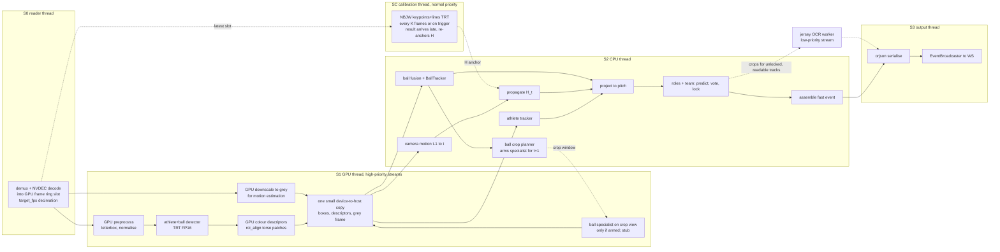

# Path B — Implementation Plan

Status (2026-10-11): **Phase 1a closed (2026-09-27). Phase 1b partly done on a Kaggle Tesla
T4** (ORT GPU parity passes; the detector TensorRT engine is not built yet). **Phase 4 is
mostly built** (NBJW on TensorRT, homography propagation, `calib_every_k: 5`). Phases 0, 2,
3, 5, 6, 7 and 8 are not started, and nothing in `gsr_pipeline/live/` exists yet. **Phase 9 is
redefined (2026-10-12): Path B becomes the pipeline and Path A is removed; see §12.2.** See §12.1
for per-phase status. (Written 2026-09-24; revised 2026-09-25 to be performance-first;
corrected 2026-09-26 against the checkpoint and the dev machine, see §15 items 7–9, §3 on NMS
and §16 item 2; code-reviewed and fixed 2026-09-27, see `PERF_LOG.md`.)
Implements the 2026-09-23 decision in `docs/path_b/DETECTOR_AND_DATA_BLOCKERS.md`: drop the 4-class
`yolov8n_gsr.pt` detector (Path A) and move to the 2-class athlete/ball detector plus
downstream role/team classification (Path B). Replacing the detector and its class mapping is
listed under "Forbidden / Dangerous Changes" in `AGENTS.md`; the user explicitly authorised it
on 2026-09-24.

Goals:

1. **Path B, live and batch**: detection, roles and teams, ball crop and specialist, tracking,
   jersey OCR and calibration.
2. **As fast as possible on one RTX 30-series GPU**: the live path is designed around latency
   and throughput from the start, not tuned after the fact.
3. **Every cost measured**: every stage is timed per frame and logged durably, so each
   optimisation is proven by numbers and every regression is visible.

---

## 0. Performance principles

Every stage in this plan follows these rules. A change that breaks one needs a `PERF_LOG.md`
entry showing why.

1. **Only the minimum on the critical path.** A fast event needs detection, tracking, a
   homography, and role/team labels. Everything else (full calibration, OCR, the ball
   specialist) runs beside it or behind it.
2. **Frames stay on the GPU.** Decode (NVDEC), pre-processing and inference never round-trip a
   full frame through host memory. Only small results come back to the CPU: boxes, colour
   descriptors, a downscaled grey frame for motion estimation, and throttled jersey crops.
3. **No pandas or per-row Python on the live path.** Per-frame data is a set of preallocated
   numpy arrays (§1.3). DataFrames exist only at the batch/evaluation boundary.
4. **Allocate once.** A fixed GPU frame ring, fixed TensorRT input/output buffers, and pinned
   host buffers. No allocation per frame in steady state.
5. **Pipeline across frames.** Separate stages overlap on consecutive frames, so throughput is
   bounded by the slowest stage, not the sum of all of them.
6. **Skip work that can't change the answer.** Propagate the homography instead of
   recomputing it every frame. OCR only unlocked, readable tracks. Run the specialist only when
   armed.
7. **The fast path owns the GPU.** CUDA stream priorities put the fast path first; background
   work (OCR) gets low priority and yields to it.
8. **The newest frame wins.** Never queue latency. When behind, drop stale frames, and count
   the drops.
9. **Measure, and gate accuracy.** Every optimisation is A/B tested in `PERF_LOG.md`. Anything
   that changes numerics (FP16, rectangular input, GPU colour descriptors, homography
   propagation) also has to pass an accuracy gate before it becomes the default.

---

## 1. Live architecture

### 1.1 Stages and threads



- **S0 reader** decodes on NVDEC, a hardware engine separate from the GPU's compute units, so
  decode doesn't compete with inference. It writes into a free slot of the GPU frame ring and
  publishes "latest slot".
- **S1 GPU thread** does everything that touches the full frame, then makes **one** small
  device-to-host copy per frame.
- **SC calibration thread** runs the full NBJW model at a lower rate. Its results arrive a few
  frames late, and S2 re-anchors the homography when they do (§7). Calibration is never on the
  critical path.
- **S2 CPU thread** is all small-array work: camera motion, tracking, fusion, projection,
  roles, crop planning, event assembly.
- **S3 output thread** serialises and hands events to the WS broadcaster, so JSON work never
  delays S1 or S2.
- Stages are connected by **one-slot "latest wins" handoffs**, not queues. When a stage falls
  behind, the stale item is overwritten and counted as a drop (§10.1).

End-to-end latency for one frame is S0 + S1 + S2 + S3. Sustained throughput is set by the
slowest single stage.

### 1.2 Why threads work here, and where they won't

TensorRT, NVDEC, torch and OpenCV release the GIL during heavy work, so threads overlap for
real. The S2 CPU stage is numpy on small arrays, which holds the GIL only briefly. If the perf
log or `py-spy --gil` shows GIL contention limiting S2, the fix is to move S2 into its own
process with shared memory. That is a measured escalation, not the default, because
cross-process hand-off costs more than it saves at this data size.

The user asked for the ball crop planner to run in parallel to role classification. In this
design they are **independent in the dataflow**: neither waits for the other, and the crop
window is only needed by the next frame's S1. Both take microseconds, so they run
back-to-back on the S2 thread. Handing them to separate threads would cost more (~50–100 µs of
hand-off each) than the work itself. `PERF_LOG.md` records the measured costs to confirm this.

### 1.3 Frame and detection representation

- **GPU frame ring:** `frame_ring.slots` (start 4) preallocated `uint8` tensors of shape
  `(1080, 1920, 3)` on the GPU, each with a reference count. The reader writes into a free
  slot; if none is free, the oldest unconsumed slot is dropped. Background jobs never hold a
  slot: they receive copied crops.
- **`FrameDetections`** (new `gsr_pipeline/live/detections.py`), a dataclass of numpy arrays:
  - athletes: `boxes (N,4) f32` (ltrb px), `conf (N,)`, `track_id (N,) i32` (−1 = none),
    `pitch_xy (N,2) f32` (NaN = unprojected), `descriptor (N,3) f32`, `role (N,) i8`,
    `team (N,) i8`, `role_provisional (N,) bool`, `role_locked (N,) bool`
  - ball: at most one fused row: box, conf, `source` (main / specialist), pitch_xy,
    `track_id`, `frames_since_seen`
  - calibration: `H (3,3) f64`, `h_source` (fresh / propagated / reused), `h_age_frames`
  - timing: `frame_idx`, `timestamp_ms`, perf record handle
- `FrameDetections.to_dataframe()` produces today's column names, so the batch path,
  `evaluate*.py` and `PitchViewGate` keep working unchanged.
- This changes `AGENTS.md` Architecture Rule 1 (the DataFrame contract) **for the live path
  only**. The batch path keeps DataFrames.

### 1.4 Per-frame budget (targets, RTX 3060 as the floor)

These are **targets to verify**, not measurements. Phase 0 and each later phase replace them
with real numbers in `PERF_LOG.md`. The exact card isn't confirmed; the RTX 3060 is the
conservative floor of the series (§16).

| Stage | Resource | Target |
|---|---|---|
| decode 1080p | NVDEC (separate from compute units) | ≤ 3 ms |
| preprocess (letterbox, normalise) | GPU | ≤ 1 ms |
| detector, YOLO26s 1280×736 FP16, **including NMS** | GPU | ≤ 12 ms |
| colour descriptors + downscale + device-to-host copy | GPU / copy | ≤ 1.5 ms |
| ball specialist (only when armed) | GPU, own stream, overlapped | ≤ 5 ms |
| camera motion estimate | CPU | ≤ 2 ms |
| track + fuse + project + roles + crop plan | CPU | ≤ 3 ms |
| serialise + enqueue | CPU, S3 | ≤ 1 ms |
| NBJW full calibration | GPU, SC thread, off the critical path | ≤ 25 ms per run, every K frames |

Headline targets: **`e2e.fast` p95 ≤ 25 ms** (hard ceiling 40 ms), **25 fps sustained with
zero drops** over a 30-minute soak (§12, Phase 7), and enough GPU headroom left for jersey OCR.

---

## 2. Frame source and decoding

- **NVDEC decode** into the GPU frame ring, via NVIDIA's `PyNvVideoCodec`, with DLPack
  hand-off into torch without a copy. For live RTMP/RTSP/HLS, check PyNvVideoCodec's
  network-stream support in Phase 2. If it has none, demux with PyAV (CPU, cheap; it only
  splits packets) and feed the packets to NVDEC. Decoding is the expensive part, and it stays
  on NVDEC either way.
- **Keep reading the newest frame.** The reader thread runs flat out and always publishes the
  newest decoded frame. `LiveBroadcastFrameSource`'s reconnect logic (backoff,
  `disconnect_reason`) is kept by wrapping it, not rewritten.
- **`target_fps` decimation** (default 25). Broadcasts are often 50p. At 50 fps, process every
  second frame **deterministically** rather than letting "newest wins" pick frames with
  irregular gaps, which would jitter the tracker's motion model. NVDEC still decodes every
  frame, which is required for inter-frame compression and cheap on the decode engine.
- **CPU fallback:** with no CUDA, the reader decodes with OpenCV/FFmpeg into host memory, and
  the whole pipeline runs host-side (§3.1 tier 3). This is degraded mode.
- The existing `FrameSource` classes stay for the batch path and tests.

---

## 3. Stage 1 — athlete + ball detection

**Model:** `runs/yolo26s_athlete_ball/best.pt`. YOLO26s, 2 classes (`athlete`,
`ball`), trained at `imgsz=1280` (`args.yaml`). Needs `ultralytics>=8.4.0` for export
only (§3.2).

**The head is not end-to-end; NMS is required** (corrected 2026-09-26). Verified by
loading the checkpoint: the last module is a plain `Detect` with `end2end=False`,
`nc=2`, `reg_max=1`, `max_det=300`, strides `[8, 16, 32]`, names `{0: athlete, 1: ball}`.
An earlier revision of this plan claimed an "NMS-free end-to-end head (`nms: null`)".
That was wrong: `nms: null` in `args.yaml` is an unset export/predict argument, not
evidence of an end-to-end head. `reg_max=1` **is** a genuine YOLO26 trait — the box
decode is DFL-free and therefore cheaper than YOLOv8's — but that is a different
property from being NMS-free. Consequences are tracked in §3.3 (post-processing),
§3.5 (the parity gate must match Ultralytics' NMS parameters) and §1.4 (the detector
budget covers NMS).

### 3.1 Backends and fallback chain

| Priority | Backend | Artifact | Selected when |
|---|---|---|---|
| 1 | TensorRT FP16 | `best_<h>x<w>_fp16.engine`, built on install from the ONNX | `tensorrt` importable, CUDA device present, engine sidecar matches this GPU / TRT version / ONNX checksum, warm-up succeeds |
| 2 | ONNX Runtime GPU | `best_<h>x<w>.onnx` (the shipped artifact) | `CUDAExecutionProvider` available and actually active on the session, warm-up succeeds |
| 3 | ONNX Runtime CPU | same `.onnx` | always; **degraded mode**, not real-time (0.73 s/frame measured at 1280 on CPU) |

- **Fallback at load time**, in priority order: log why each tier was rejected.
- **Fallback at runtime** (CUDA OOM, lost device): drop one tier **once**, log at ERROR, and
  report it in `/health`. Never flip-flop.
- **Verify the active backend, don't infer it.** ORT silently falls back to CPU if the CUDA
  provider fails to load. Read `session.get_providers()` after creating it. The active backend
  goes in the perf log header and `/health`.

### 3.2 Artifacts: ONNX shipped, engine built on install

Decided 2026-09-25. TRT engines are specific to GPU model, driver and TRT version, so they
can't be shipped prebuilt.

- *Release (dev machine, once per model version):* `scripts/export_athlete_detector.py`
  exports `best.pt` → `best_<h>x<w>.onnx` (pinned opset, static shape, `simplify=True`). It
  writes `best_<h>x<w>.onnx.json` with class names, input size, stride, the output tensor
  layout, and a checksum.
- **The ONNX graph carries no NMS** (decided 2026-09-26; see §3 on why NMS is needed at
  all). Export is raw: `nms=False`, so the graph ends at the decoded `(1, 4 + nc, N)`
  head output, and NMS runs host-side in torch, shared by all three tiers (§3.3).
  The alternative — Ultralytics' `nms=True`, which appends NMS to the graph — was
  rejected because TensorRT and ONNX Runtime would then execute *different* NMS kernels:
  a parity-gate failure could not be attributed to preprocessing versus NMS, which is
  the one thing §3.5 exists to distinguish. One shared implementation also means the
  tier-3 CPU gate genuinely exercises the same post-processing the GPU tiers will use.
- *First install (production host):* the engine `best_<h>x<w>_fp16.engine` is built with the
  TensorRT Python builder: FP16 flag, static batch 1, and the builder optimisation level at its
  maximum (a slower build for a faster engine; it runs once). It writes a sidecar with GPU name,
  compute capability, driver, CUDA and TRT versions, and the ONNX checksum. **Since 2026-10-15
  the pipeline builds it itself at startup** whenever the engine file is missing
  (`trt_runner.ensure_engine`, called by `select_backend` and by NBJW's `_nbjw_runner`;
  config `detector_b.auto_build_engine` and `calibration.auto_build_engine`, both default
  true). The build writes temporary files and renames them when done, so a killed build leaves
  no engine; a `.building` lock stops two processes building at once (the second falls back a
  tier). Without TensorRT installed, or with auto-build off, a missing engine still means
  falling back to ORT GPU. `scripts/build_trt_engine.py` remains for building ahead of time.
- *Startup:* on a sidecar mismatch, **refuse the engine**, log at ERROR that
  `build_trt_engine.py` must be re-run, and continue on ORT GPU. Auto-build covers only a
  *missing* engine: a mismatched one is never overwritten automatically.

### 3.3 Runtime: a thin runner, not Ultralytics

At runtime the detector does **not** go through `YOLO(...)`. Ultralytics' per-call Python
overhead is avoidable on the hot path: it builds `Results` objects, and today's `detect.py`
loops over boxes calling `.cpu()` on each, where every call is a GPU sync. Post-processing is
a handful of tensor ops plus one NMS call, all on the GPU. Ultralytics stays as the export tool
and as the reference for the parity gate (§3.5).

New `gsr_pipeline/runtime/`:

- `trt_runner.py`: a generic TensorRT 10 runner. It deserialises the engine once, preallocates
  input and output buffers as torch CUDA tensors, binds them with `set_tensor_address`, and runs
  `execute_async_v3` on a caller-supplied stream. The ball specialist and NBJW reuse it.
- `ort_runner.py`: ORT with **IOBinding** bound to the same torch GPU buffers (tier 2, no host
  copies), or plain numpy (tier 3).
- `detect_athlete.py` → `AthleteBallDetector`:
  1. **Preprocess on the GPU**, reading straight from the frame-ring slot: BGR→RGB, resize
     (bilinear) to 1280×720, pad to the engine height with Ultralytics' padding value
     (114/255), normalise, and write **in place** into the input buffer. This must match
     Ultralytics' `letterbox` closely; the parity gate catches any drift.
  2. Run the engine on the S1 high-priority stream.
  3. **Post-process on the GPU**, in this order: split the `(1, 4 + nc, N)` output into
     boxes and per-class scores; convert `xywh` (centre form, as the head emits) to `xyxy`;
     apply the per-class thresholds (`athlete_conf`, `ball_conf`); run **class-aware NMS**
     (`torchvision.ops.batched_nms`, `iou=0.7` and `max_det=300` to match the training
     config, §3.5); then map the surviving boxes from letterbox coordinates back to frame
     pixels. The output layout is read from the ONNX JSON at load, not assumed.
     Thresholding before NMS matters: at ~25 athletes and `nc=2` it keeps NMS well under
     the sub-millisecond mark, so this step does not threaten the §1.4 budget. The same
     function serves all three tiers, so their numerics are identical by construction.
  4. Leave results **on the GPU** for the descriptor step (§4.2). They are copied to the host
     together with the descriptors in S1's single copy.
- **CUDA graphs:** with static shapes, preprocess + engine + post-process can be captured once
  and replayed each frame, which cuts kernel launch overhead. Small models at batch 1 are often
  launch-bound, so this may matter. Measured optimisation, Phase 7.

### 3.4 Input size and precision

- **Rectangular engine:** 1280×736 (16:9 at stride 32) instead of a 1280×1280 square,
  removing ~44% padding compute. Adopt it if the parity gate shows no ball-recall loss. The
  model was trained on square mosaics, so this has to be checked.
- **FP16** is the default. **INT8** (post-training quantisation, calibrated on GSR `train`
  frames) is a later, measured option, only if the detector still dominates the budget after
  everything else. The ball is the first thing INT8 would damage, so it gets the same ball gate.

### 3.5 Parity and accuracy gate

`evaluate_detection.py` gets a `--weights` / `--backend` flag and a 2-class scoring mode
(people class-agnostic, as in the blockers doc §2 table). Compare Ultralytics `.pt` (the
reference) against runner + TRT FP16, runner + ORT GPU and runner + ORT CPU on ≥ 3
sequences. **Pass:** within 1 point of `.pt` on ball recall and precision and on people
recall. Otherwise the failing variant doesn't ship, and `PERF_LOG.md` records why.

**Square vs. rectangular is not part of this gate** (corrected 2026-09-26). An earlier
revision said to run the parity gate "for both square and rectangular input". That is not
possible: Ultralytics' predictor uses `LetterBox(auto=True)` and pads only to a stride
multiple, so on a 1920×1080 frame it feeds the model 736×1280 whatever `imgsz` is
requested — there is no square reference to compare against. Attempting it produces a
large spurious failure that looks like a runner defect (see `PERF_LOG.md`, 2026-09-26).
The square/rectangular choice is therefore settled by two other measurements: **accuracy**,
by scoring both exports against ground truth, and **speed**, on a GPU.

Three things this gate depends on, all added in Phase 1:

1. **Match Ultralytics' NMS parameters exactly**, or the comparison measures the wrong
   thing. The reference is `YOLO(best.pt)` at `iou=0.7` and `max_det=300` (from
   `args.yaml`), **not** today's `detect.py` defaults, which use `iou_threshold=0.45`.
   A mismatch here shows up as a box-count difference that looks like a preprocessing bug.
2. **A frame-range flag.** The blockers-doc reference numbers (77% / 78% ball recall and
   precision at conf 0.25; 79% / 71% at 0.15) are **open-play only — frames 168–749** —
   because the kickoff segment is missed by every model at every threshold and would
   swamp the comparison. `evaluate_detection.py` today has `--max_frames` but no start
   frame, so it cannot reproduce those numbers. Add `--start_frame`.
3. **The 2-class scoring mode is more than a flag.** `CLASS_NAMES` is a hardcoded 4-class
   dict and predictions map `class_id` straight to a role; with `{athlete, ball}` that
   mapping collapses. Ground-truth `player`/`goalkeeper`/`referee` must be folded into one
   `athlete` class, scored class-agnostically (the existing class-agnostic person matcher
   is the right thing to reuse), with the ball scored separately on centre distance as now.

**Sequences are available.** `SoccerNetGS/gamestate-2024/valid.zip` at the monorepo root
holds all 58 `valid` sequences (`train.zip` holds the train split). Five are extracted to
`cv_service/data/.../valid/`: SNGS-021, 022, 033, 047, 090 — comfortably past the ≥ 3
this gate asks for. That directory is gitignored, so extracting
more costs disk only.

### 3.6 Output

Class indices come from the ONNX JSON's names; loading fails unless they are exactly
`{athlete, ball}`. Per-class thresholds: `athlete_conf` (start 0.25, compare 0.4) and
`ball_conf` (start 0.15). Blockers doc §2 reference: 77% / 78% open-play ball recall /
precision at 0.25, and 79% / 71% at 0.15.

---

## 4. Stages 2 + 3 — role and team classification

### 4.1 What exists

`athlete_roles.py` (`AthleteRoleTeamClassifier`) does **both** role and team in one
`predict()`: the nearest kit colour gives the team, and colour plus pitch position gives the
role. It isn't a separate team stage. What's missing is a live version: `fit()` is one-shot,
and per-detection labels flicker.

### 4.2 `LiveAthleteRoleClassifier` (`gsr_pipeline/live/athlete_roles_live.py`)

Replaces `LiveTeamAssigner` on Path B.

1. **Colour descriptors on the GPU, in batch.** In S1, straight after detection:
   `torchvision.ops.roi_align` pulls every athlete's torso region (the same fractions as
   `torso_descriptor`) from the frame-ring slot into fixed 16×16 patches (all athletes in one
   call). Then, in torch: HSV grass mask → Lab conversion **matching OpenCV's 8-bit Lab
   scaling** (the fitted distances and `merge_dist` were tuned on that scale) → masked median.
   The result, `(N,3)` floats, rides along in S1's single copy. This replaces ~25 per-crop
   OpenCV calls on the CPU.
   **Accuracy gate:** resampling to 16×16 patches changes the median slightly. Re-run
   `evaluate_athlete_roles.py` with GPU descriptors; team and role accuracy must stay within
   0.5 points of the CPU descriptors, or the patch size goes up until they do. On the CPU
   fallback, the existing `torso_descriptor` is used, and only for **unlocked** tracks plus a
   1 Hz sample of locked ones (for refits).
2. **Why there is a cold start at all.** The classifier is unsupervised and fitted per match.
   It learns kit colours by clustering the people it sees. A team kit is a colour that
   appears several times per frame; everything else is a minor colour (keepers, officials).
   Before the first pitch-view frame it has nothing to compare against. One pitch-view frame
   (~20 athletes) is technically enough to fit.
3. **Provisional fit from the first pitch-view frame** (decided 2026-09-25). Fit on the first
   frame that passes `PitchViewGate`, and emit roles and teams from then on with
   `role_provisional: true`. Refit on the growing window at gated frames 1, 5, 25 and
   `bootstrap_frames` (start 50). Per-track votes carry across refits.
   **Measure it:** `evaluate_athlete_roles.py --fit_frames` at 1, 5, 25 and 50. If one-frame
   accuracy is unusable, raise the first fit point, never the publish delay.
   - Only frames before the first pitch view produce `unclassified` athletes, and those aren't
     published as positions.
   - Kit colours from match setup (`TODO.md`) would seed the team centres and remove the team
     half of the cold start.
4. **Refits run off the hot path.** KMeans (`n_init=10`) costs milliseconds to tens of
   milliseconds, so refits run on a background thread against a snapshot of the reservoir. S2
   keeps predicting with the current centres and swaps in the new ones atomically when ready.
   Periodic refit every `refit_interval_s` (start 120 s) on a bounded reservoir (~5,000
   samples).
5. **Stable team identity across refits:** match new team centres to old ones (2×2 nearest
   assignment) so `team_a` never silently swaps. Warn if the match distance is large.
6. **Per-track vote and lock:** a confidence-weighted vote per `track_id`. Emit the running
   winner, and lock at `lock_min_votes` with `lock_margin`. Locked tracks skip `predict`.
   `predict` itself is vectorised (`np.select` over all rows), not a per-row loop.
7. **Missing pitch position** (projection failed): team from colour alone. Role is `player`
   for a team kit, otherwise the track's current vote, otherwise `unclassified`.
8. **Half-time flip from where each team plays** (decided 2026-09-25, the design, not a
   stopgap). Compare each team's mean pitch x over a sliding window with the side it held at
   fit time, with hysteresis, and log every flip. No hardcoded or manual half. The future
   scoreboard reader (`TODO.md`) is for exact match time, score and cards, not for this.

### 4.3 Output contract

The six labels become codes in `FrameDetections` and strings on the wire, split into two
fields so existing consumers keep working:

| `athlete_roles` label | `role` | `team_label` | `team` (side) |
|---|---|---|---|
| `player_team_a` / `_b` | `player` | `a` / `b` | `left` / `right`, from which end the team defends |
| `goalkeeper_team_a` / `_b` | `goalkeeper` | `a` / `b` | `left` / `right` |
| `referee` | `referee` | null | null |
| `other` | `other` | null | null |
| (before the first pitch-view frame) | `unclassified` | null | null |
| ball | `ball` | null | null |

Every athlete also carries `role_provisional` and `role_locked`.

Consumers that change in the same PR:

- `api/event_serializer.py`: replaced by array-to-JSON serialisation (§9). `team`,
  `team_confidence` and `team_locked` move from appearance events to **fast events**. Add
  `team_label` and `role_provisional`.
- `data_ingestion/.../cv_pipeline_source.py` `_ROLE_EVENT_TYPES`: add `"other"` and
  `"unclassified"` as **explicit skips**, and read team from fast events. It lives in a separate
  repo; ship both changes together.
- `evaluate_team_live.py`: point it at the new classifier.

---

## 5. Stage 4 — ball crop planner and specialist ball detector

### 5.1 Behaviour (as specified)

The planner computes **crop coordinates only**. It never slices the frame. When the
specialist runs, its "crop" is a view of the GPU frame-ring slot (no copy) at native
resolution.

State machine, per frame `t`:

| Main detector at `t` | Action |
|---|---|
| ball found | `crop_window` = window centred on the ball at `t`. **Disarm**: the specialist won't run at `t+1`. |
| no ball, `crop_window` exists | **Arm** the specialist for `t+1` with the last `crop_window`. |
| no ball, specialist found it at `t` | Use the specialist's ball for frame `t`. Re-centre `crop_window` on it. Stay armed for `t+1`. |
| no ball from either, armed | Stay armed. Grow the window by `grow_factor` per missed frame, capped at `max_crop_px`. Disarm after `max_miss_frames` (start 25 ≈ 1 s). |

Worked timeline:

| frame | main detector | specialist runs? | ball used |
|---|---|---|---|
| 100 | ball at (812, 440) → window W centred there | no | main |
| 101 | miss | no (disarmed at 100) → **arm for 102 with W** | none |
| 102 | miss | **yes, on W of frame 102, in parallel with main** → finds ball | specialist; re-centre W |
| 103 | ball found | yes (armed at 102), result discarded in favour of main | main; **disarm for 104** |
| 104 | ball found | no | main |

The first missed frame (101) never gets a specialist attempt. Because the specialist runs in
parallel with the main detector, it reacts one frame late. That keeps it off the critical path,
which is the point. The quality logs count these one-frame gaps.

### 5.2 Crop window

- **Size:** fixed `crop_px` (start 640×640 native pixels). A 10–25 px ball stays 10–25 px.
- **Clamp by shifting, not shrinking**, so the window stays full-size at frame edges.
- **Camera motion compensation:** shift the window by the camera motion estimate for `t → t+1`
  (§6.1), which S2 already computes. Cost is ~0; without it, a panning camera moves the ball
  out of a stale window. `crop_center: last_seen` shifted by camera motion is the default;
  `predicted` (plus the ball's own velocity) is an option to evaluate once a real specialist
  exists.

### 5.3 Specialist interface (stub now)

```python
class BallSpecialist(Protocol):
    def detect(self, frame_gpu: "torch.Tensor", window: CropWindow, stream) -> list[BallDetection]: ...
    # boxes in FULL-FRAME pixel coordinates
```

- `CropWindow`: dataclass `(x0, y0, x1, y1, source_frame_idx, miss_count)`.
- The specialist runs on **its own high-priority CUDA stream** in S1, launched at the same time
  as the main detector, so on the GPU the two genuinely overlap.
- `StubBallSpecialist` returns `[]` but goes through the real launch, synchronisation and
  timing path, so the scheduling and fusion logic are exercised and measured before the model
  exists.
- The real model will use `trt_runner.py` with its own ONNX → engine build (§3.2).

### 5.4 Ball fusion and tracking (`gsr_pipeline/live/ball_tracker.py`)

The ball bypasses the athlete tracker: it is tiny and fast, so box-overlap association fails.

- Candidates: main-detector balls plus specialist balls.
- Choose at most one with a constant-velocity Kalman prediction in camera-motion-compensated
  pixel space, gated by distance, then by confidence. Prefer main over specialist at equal
  distance.
- Output: one ball row with a persistent `track_id`, `source ∈ {main, specialist}` and
  `frames_since_seen`, carried to the wire.
- Report ball recall and longest gap after fusion, alongside the per-detector numbers.

---

## 6. Stage 5 — camera motion and tracking

### 6.1 One camera-motion estimate, three consumers

New `gsr_pipeline/live/camera_motion.py`. S1 downscales the frame to grey on the GPU (start
480×270) and includes it in the single device-to-host copy (~130 KB). S2 tracks sparse
Lucas–Kanade features between frames, masks out athlete boxes (players move independently of
the camera), and fits a RANSAC homography `M(t−1→t)`.

That single estimate feeds:

1. **The tracker**: camera-motion compensation (§6.2).
2. **Homography propagation**: calibration off the critical path (§7).
3. **The ball crop window** (§5.2) and the ball Kalman filter (§5.4).

Scene cuts show up as a low inlier ratio or a large grey-frame difference. They reset the
tracker's motion assumptions, trigger a fresh NBJW run, and feed `PitchViewGate`.

### 6.2 Tracker

**Recommendation:** ByteTrack as the baseline, with **BoT-SORT with camera-motion compensation
(and ReID off)** A/B tested against it. Plain ByteTrack predicts in pixel space, so a broadcast
pan moves every player at once and IDs switch. That breaks the per-track role vote and jersey
vote. Ultralytics' BoT-SORT runs its own motion compensation on the full frame. Here that
hook is overridden to take the §6.1 estimate (as a 2×3 affine), so motion is computed once.

Decide on measurement: AssA / IDF1 on GSR `valid` sequences (batch path, §11) plus tracker
ms/frame. Adopt BoT-SORT only if the AssA gain justifies its cost.

Regardless of tracker:

- **Use the tracker's detection index** (the last output column) instead of `track.py`'s
  greedy `iterrows` IoU re-matching, which is O(N×M) Python and can attach a track to the wrong
  box. It is exact and costs nothing.
- Feed numpy arrays straight in (no `TrackerInput` wrapper classes rebuilt per frame), and
  athletes only.

---

## 7. Stage 7 — calibration off the critical path

Per-frame NBJW (two HRNet models: keypoints and lines) is probably the most expensive thing
in today's pipeline. The fast path no longer waits for it.

**Build status (2026-10-03).** The 2026-10-03 T4 eval measured `calibrate` at 479.9 ms/frame on a T4. Most of
it was not the networks: `NBJWHomography.compute` ran NBJW's `heuristic_voting` (18
`cv2.calibrateCamera` fits on the CPU) every frame, only to fill the `camera_parameters`
passthrough. Built:
- `calibration.compute_cam_params` (default false) gates that voting.
- Item 1: `scripts/export_nbjw.py` (ONNX export, `--build_engine` for TRT FP16, `--check` parity
  in metres). `NBJWKeypointDetector` takes `backend` torch | auto | tensorrt | ort_gpu | ort_cpu,
  and preprocessing runs on the device instead of PIL. Export and ORT CPU parity are verified on
  the dev machine. The TRT engine build and the GPU timings are **unverified** (no CUDA here).
- Items 2 and 4: `camera_motion.py` (LK flow, RANSAC homography, player boxes masked) and
  `calibration_live.py` (`LiveCalibrator`: every-K + triggers, inline or async re-anchoring,
  `h_source` / `h_age_frames` per frame as DataFrame columns). These are not on the WS wire yet:
  that needs a matching change in `data_ingestion`'s `CVPipelineSource`.
- Item 3: `python -m gsr_pipeline.evaluate_calib_propagation`. The config default is now
  `calib_every_k: 5`, chosen on SNGS-021 only (0.58 m vs GT, against 0.59 m at K=1; 0.18 m from
  per-frame NBJW). The gate asks for several valid sequences, so K=5 is provisional.
- Item 5: `project_detections` is vectorised. Dropping implausible projections is not built.
- Since 2026-10-07 (`docs/path_b/plans/OPTIMIZATION_PLAN.md` §7): `nbjw_fast_decode.py` gives the same
  keypoints as the vendored decode, faster (`calibration.fast_decode`, default on), and
  `min_trigger_interval_frames: 3` stops NBJW from running on every frame of a close-up.
- Measured on a Kaggle T4 (2026-10-05, `docs/results/PATH_B_EVAL_T4_2026-10-05.md`): NBJW keypoint and line engines
  (TRT FP16) take 32.9 ms and 37.6 ms. Calibration dropped from 479.9 ms/frame to 37.5 ms mean
  (p95 128.8 ms on frames that run NBJW). The FP16 projection gate (item 1) and the
  multi-sequence propagation gate (item 3) have not been run yet.

1. **NBJW on TensorRT.** `scripts/export_nbjw.py` exports both NBJW torch models to ONNX at the
   input size NBJW uses. The install step builds FP16 engines with the same
   `build_trt_engine.py`, and they run through `trt_runner.py` with GPU preprocessing from the
   frame-ring slot. The vendored `nbjw_calib` package is **not edited**: the runner replaces
   only its forward calls, and its heatmap → keypoint → homography post-processing is reused.
   If that post-processing shows up in the perf log, port the heatmap peak-finding to the GPU.
   **Gate:** projection error of the FP16 engines against the torch FP32 models on GSR
   sequences, in metres.
2. **Propagate, then re-anchor.** The fast path uses `H_t = H_anchor · M(anchor→t)⁻¹`: the last
   full NBJW homography composed with the camera motion accumulated since then (a short ring of
   `M`s). The SC thread runs full NBJW every `calib_every_k` frames (start 5) and immediately
   on triggers: scene cut, low motion-inlier ratio, large zoom change (from `M`'s scale), or
   `h_age_frames` over a cap. When a result arrives a few frames late, S2 re-anchors to it and
   re-applies the motion accumulated since that frame.
3. **Accuracy gate:** on GSR `valid` sequences, compare pitch positions from propagated H
   against per-frame NBJW and against GT pitch positions, as mean and p95 error in metres per
   `calib_every_k`. Pick the largest K that holds error within 0.5 m of per-frame NBJW.
   Otherwise fall back to K = 1, still off the critical path.
4. `h_source` (fresh / propagated / reused) and `h_age_frames` are logged per frame and sent on
   the wire, so consumers and evaluation can see how each position was computed.
5. Projection (bottom centre for athletes, box centre for the ball) is a vectorised
   `cv2.perspectiveTransform` on the arrays. Drop implausible projections
   (`PIPELINE_EVOLUTION.md` §7.13): athletes beyond the margin become `other`, and the ball's
   pitch position is nulled beyond it (its pixel position is kept). Output is metres from the
   pitch centre; the 0–1 normalisation (§3.5 of PIPELINE_EVOLUTION) happens at serialisation.
6. Known limitation, out of scope: the fixed 105×68 template (`PIPELINE_EVOLUTION.md` §7.12).

---

## 8. Stage 6 — jersey number recognition

- `JerseyRecognizer` protocol (`recognize(crops) -> list[(number | None, conf)]`), selected by
  `jersey.impl`. EasyOCR is today's implementation; the model is expected to change.
- **Recognition only.** Crops are already player torsos, so EasyOCR's text *detector* (CRAFT,
  the expensive half) is skipped. Call its recogniser on the given crop region
  (`reader.recognize` with explicit boxes), with `allowlist="0123456789"`.
- **Crops come from the GPU:** `roi_align` cuts the back/number region at a fixed size (start
  64×128) from the frame-ring slot. Only these crops are copied to the host, and only for
  throttled tracks. The worker never holds a full frame. Today's pool holds whole 6 MB frames
  per job, up to 8 at a time.
- **Per-track throttling:** OCR a track only if it is a `player`/`goalkeeper`, not yet
  jersey-locked, its box is at least `min_box_height_px` tall (52% of player boxes on SNGS-021
  had no visible number), and it hasn't been tried in the last `ocr_interval_frames`.
  Throttled tracks are batched into one `recognize` call per job.
- **Low-priority GPU stream:** if OCR runs on the GPU, it runs on a low-priority CUDA stream so
  it yields to S1. Whether GPU or CPU OCR is cheaper overall is measured: the aim is lowest
  impact on `e2e.fast`, not fastest OCR.
- `ReidWorkerPool` → `AppearanceWorkerPool`: ReID leaves the live path (its only live consumer
  was `LiveTeamAssigner`). Batch `refine.py` keeps ReID.
- Jersey voting and `PLAYER_IDENTIFIED` emission logic are unchanged.

---

## 9. Serialisation and output

- S3 builds wire messages **directly from `FrameDetections` arrays** with `orjson` (a new
  dependency, several times faster than `json`). No per-row DataFrame access.
- The WS message shape stays JSON and backward-compatible for `data_ingestion`, plus the new
  fields (`team_label`, `role_provisional`, `role_locked`, ball `source`, `h_source`).
- `EventBroadcaster` keeps its bounded drop-oldest queue. Its drops are logged in the perf
  record.

---

## 10. Latency instrumentation and performance logs

### 10.1 What gets recorded

Per frame, every stage gets a **duration and a start offset** relative to frame decode, which
shows overlap and the critical path:

| Stage key | Covers | Timed with |
|---|---|---|
| `s0.decode` | NVDEC decode into slot | CUDA event |
| `s1.preprocess`, `s1.detect`, `s1.postprocess` | detector path | CUDA events |
| `s1.specialist` | only when armed; plus `ran`, `found` | CUDA events |
| `s1.descriptors`, `s1.downscale`, `s1.d2h` | descriptors, grey frame, the single copy | CUDA events |
| `s1.wall` | S1 host wall time, including sync | `perf_counter_ns` |
| `sc.nbjw` | full calibration run; plus trigger reason | CUDA events + wall |
| `s2.camera_motion`, `s2.track`, `s2.ball_fusion`, `s2.project`, `s2.roles`, `s2.crop_plan`, `s2.assemble` | CPU stages | `perf_counter_ns` |
| `s3.serialize`, `s3.enqueue` | output | `perf_counter_ns` |
| `handoff.s0_s1`, `handoff.s1_s2`, `handoff.s2_s3` | time a frame waited between stages | `perf_counter_ns` |
| **`e2e.fast`** | decode done → fast event enqueued. **The headline number.** | `perf_counter_ns` |
| `appearance.ocr`, `appearance.staleness` | OCR job; frame → jersey result delivered | wall |

Per-frame fields: athlete and ball counts, `h_source`, `h_age_frames`, role refit in
progress, and drops at every handoff and queue (frame ring, S1→S2, S2→S3, WS, OCR).

**1 Hz device sample** via NVML (`pynvml`): GPU compute and memory utilisation, NVDEC
utilisation, memory used, SM clock, power, and **temperature and throttle reasons**. Consumer
RTX cards throttle under sustained load, which shows up as slow p99 drift in a long run, not
in a 30-second test.

**Startup, once:** each model's load time, engine deserialise, CUDA graph capture, warm-up
iterations, and first-inference latency.

### 10.2 How GPU time is measured without stalling the pipeline

- GPU stages record **CUDA events** on their stream at start and end. The perf writer thread
  reads the elapsed time later, once the events have completed. This gives exact per-stage GPU
  durations **with no synchronisation on the hot path**. The old approach (a global
  `torch.cuda.synchronize()` switch) serialises the GPU and is kept only as
  `perf.debug_sync: true` for debugging.
- CPU stages use `time.perf_counter_ns()`.
- `perf.nvtx: true` wraps every stage in NVTX ranges, so an **Nsight Systems** capture
  (`nsys profile -t cuda,nvtx,osrt`) shows the real overlap of stages, streams, NVDEC and
  copies on one timeline. `py-spy record --gil` covers CPU and GIL questions. The recipes go
  in `PERF_LOG.md`.
- Recorder overhead budget: under 0.1 ms per frame, verified in a no-op run.

### 10.3 Where it goes

- **JSONL per stream**, `data/outputs/perf/<stream_id>_<start_ts>.jsonl`, one record per frame, plus
  the 1 Hz device samples. A background writer drains a bounded queue: it drops and counts
  records rather than block, and never does disk I/O on a pipeline thread.
- **Header record:** git commit, config snapshot, GPU name and compute capability, driver,
  CUDA / TRT / ORT / torch / ultralytics versions, per-model backend and input size, tracker,
  `calib_every_k`, `target_fps`, source fps and resolution, and whether CUDA graphs are on.
- **Rolling summary** (per stage: p50 / p90 / p99 / max; sustained fps; drops): logged every
  `streaming.log_progress_every_n_frames` and served at **`GET /streams/{id}/metrics`** (same
  auth). `/health` reports the active backends.
- The batch path writes the same JSONL format.

### 10.4 Reading it

`scripts/perf_report.py`: per-stage percentiles, each stage's share of `e2e.fast`, the
critical path per frame (which stage bounded it, and how often), handoff waits (a sign of a
stage bottleneck), device utilisation and throttling over time, and **A/B comparison** of two
runs. Every phase adds a dated entry to `docs/path_b/PERF_LOG.md`: hardware,
numbers, what changed. Numbers from the dev machine are tagged as such and don't count against
the §1.4 targets.

### 10.5 Other runtime hygiene (measured, not assumed)

- `gc.freeze()` after startup plus raised GC thresholds, to keep Python's full collections from
  causing p99 spikes. Verify with the p99 in the soak test.
- `torch.backends.cudnn.benchmark = True` wherever a torch model remains on the GPU.
- Pinned host buffers for every device-to-host copy, and non-blocking copies on the owning
  stream.

---

## 11. Batch path (`process_sequence`) on Path B

GS-HOTA (`evaluate.py`) is the end-to-end accuracy gate, and it runs on batch output.

- Same runners, preprocessing and descriptors as the live path. Batch can use a **batch-8
  engine profile** for throughput; the live path stays at batch 1.
- Calibration: per-frame NBJW by default (the accuracy reference), or `calib_every_k` to
  measure propagation's effect on GS-HOTA.
- Roles: fit `AthleteRoleTeamClassifier` on gated frames (whole sequence, or first N to mimic
  live), predict all rows, and vote per tracklet in `tracklet_agg` (replacing the
  detector-class vote). Team comes from `athlete_roles`; `team.py`'s KMeans isn't used on
  Path B.
- `FrameDetections.to_dataframe()` bridges into the existing batch stages; `refine.py` is
  unchanged (keeps ReID).
- Output maps roles to the GSR schema (`player`, `goalkeeper`, `referee`, `other`) and side to
  GSR `team`.

---

## 12. Build phases

Each phase ends with a dated `PERF_LOG.md` entry and, where it applies, an accuracy number.
Today's `process_stream` (Path A) stays untouched as the baseline. The new live pipeline is a
separate class (`gsr_pipeline/live/pipeline_b.py`), chosen once at startup by
`pipeline.live_impl: path_a | path_b`, so there is no per-frame branching in either path.

| Phase | Work | Done when |
|---|---|---|
| **0** | `perf.py` (CUDA events, NVTX, NVML sampler, JSONL writer), `/metrics`, `perf_report.py`; `pytest` scaffolding; instrument **today's** Path A pipeline | Baseline `PERF_LOG.md` entry on SNGS-021, live via `VideoFileFrameSource` and batch; includes one Nsight Systems capture |
| **1** | `export_athlete_detector.py`, `build_trt_engine.py`, `runtime/trt_runner.py`, `runtime/ort_runner.py`, `AthleteBallDetector` (GPU pre/post-processing incl. NMS), fallback logic, 2-class `evaluate_detection` | **1a (no GPU needed):** parity gate (§3.5) passes on tier 3 (ORT CPU) vs. Ultralytics `.pt` for square and rectangular input on ≥ 3 sequences; tier selection and sidecar rejection tested with fake backends. **1b (needs a CUDA host):** same gate on tiers 1 and 2; each fallback forced live, including a mismatched sidecar |
| **2** | Live skeleton: NVDEC reader with `target_fps` decimation, GPU frame ring, S0–S3 stage threads with latest-wins handoffs, `FrameDetections`, orjson serialiser. Detector only, end to end to WS | First Path B `e2e.fast` and sustained fps numbers; drops counted correctly under forced overload |
| **3** | Camera-motion estimator; tracker (detection-index association, array input, ByteTrack vs BoT-SORT with injected motion) | AssA / IDF1 + ms/frame for both trackers; choice recorded |
| **4** | NBJW → TRT; homography propagation + async re-anchoring + triggers | FP16 projection gate and propagation gate (§7) pass; `calib_every_k` chosen from data |
| **5** | `LiveAthleteRoleClassifier`: GPU descriptors, provisional fit, background refits, identity matching, vote/lock, half-time flip; wire contract + `CVPipelineSource` | GPU-vs-CPU descriptor gate passes; end-to-end role recall on SNGS-021 held-out frames ≥ the 2026-09-23 numbers (player 99.2%, GK 100%, referee 88.1%), and measured on ≥ 3 more sequences; fit-window table (1/5/25/50) |
| **6** | Crop planner (camera-motion shifted), `StubBallSpecialist` on its own stream, ball fusion + `BallTracker` | State machine unit-tested (the §5.1 timeline); fused ball recall and longest gap reported; specialist overlap visible in Nsight |
| **7** | Tuning: stream priorities, CUDA graphs, GC settings, handoff sizes; **30-minute soak test** | §1.4 targets met on the dev GPU (or the gap explained); no memory growth, no p99 drift, throttling recorded |
| **8** | Jersey: `JerseyRecognizer`, recognition-only EasyOCR on GPU crops, throttling, low-priority stream, `AppearanceWorkerPool` | OCR impact on `e2e.fast` measured (GPU vs CPU OCR); jersey accuracy on SNGS-021 unchanged |
| **9** | **Path B becomes the pipeline; Path A is removed.** Full definition, file by file: §12.2 | §12.2 "Done when" |

**Phase 1a is being built ahead of Phase 0** (2026-09-26, at the user's direction). This is
a deliberate reordering, not an oversight. It is safe because Phase 1's deliverables — the
export script, the runners, `AthleteBallDetector` and the 2-class evaluator — do not import
`perf.py`, and because the §1.4 targets Phase 0 exists to baseline cannot be measured on
this machine anyway (§16 item 2). What Phase 1a therefore cannot do is produce the
`PERF_LOG.md` entry the phase table asks for; it records correctness and parity results
instead, and the perf baseline is picked up when Phase 0 lands on a CUDA host.

### 12.1 Status per phase (audited 2026-10-11 against the code)

| Phase | Status | What exists / what is missing |
|---|---|---|
| 0 | **Not started** | Only `pytest` exists (59 tests). No `perf.py`, `/metrics`, `perf_report.py`, NVML or Nsight. Latency today comes from `notebooks/path_b_eval.py`'s sequential timers. |
| 1a | **Closed** 2026-09-27 | Export, runners, `AthleteBallDetector`, backend fallback, 2-class `evaluate_detection`, parity gate on ORT CPU. |
| 1b | **Partial** | ORT GPU parity on a T4 passes (min IoU 0.99998, 0 count mismatches, 3 sequences). Missing: detector TRT FP16 engine and its gate, fallbacks forced live, the square-vs-rectangular decision, and a run on the RTX 30-series host. |
| 2 | **Not started** | No `gsr_pipeline/live/`, NVDEC reader, frame ring, stage threads, `FrameDetections` or orjson. Path B is not wired into `GSRPipeline` or the API. |
| 3 | **Partial** | Camera motion is built (`camera_motion.py`). ByteTrack steps on empty frames. Missing: detection-index association, array input, BoT-SORT A/B, AssA/IDF1 table. |
| 4 | **Mostly built** | See §7 build status. Missing: FP16 projection gate, multi-sequence K choice, dropping implausible projections, `h_source` on the WS wire. |
| 5 | **Not started** | `athlete_roles.py` exists as a one-shot batch classifier only; no live vote/lock, GPU descriptors or half-time flip. Role and team accuracy on GT: 95.5% and 98.2% (T4 run, 3 sequences). |
| 6 | **Partial** (2026-10-25) | `gsr_pipeline/ball_specialist.py`: `BallSpecialist` runs `c5c` (TensorRT → ORT GPU → ORT CPU) and `BallFuser` is the §5.1 state machine as gate 3 measured it (fused chain, `max_miss_frames` 15, window at the last sighting, no camera-motion shift, no window growth), in both `process_sequence` and `process_stream`. §5.3's interface changed to points: `detect(frames t-2..t, x0, y0) -> (x, y, conf)`. Unit-tested (`tests/test_ball_specialist.py`). Missing: the specialist on its own CUDA stream in parallel with the main detector (it runs inline after it, on missed frames only), `BallTracker` (Kalman, gating, coasting), and the Nsight overlap check. |
| 7 | **Not started** | Latency work moved to `docs/path_b/plans/OPTIMIZATION_PLAN.md` (its Phases 0–1 built 2026-10-07). |
| 8 | **Not started** | |
| 9 | **Mostly done** (2026-10-25, user: "archive path a completely") | `GSRPipeline` runs Path B in both modes: `AthleteBallDetector` → `BallFuser` (c5c) → ByteTrack → `LiveCalibrator` → roles from `live_roles.py` (batch: path_b_eval's fit + tracklet vote; live: buffer, fit, running vote). Path A moved to `archive/path_a/` (9.3's list) rather than deleted; config `detector_b` became `detector` and `team`, `team_live`, `pitch_view_gate` went (9.4 partly). `reid._assign_roles` removed. WS roles unchanged (`player`/`goalkeeper`/`referee`/`ball`, plus `other`), so `CVPipelineSource` needs no change (9.5 not needed for now). Not done: 9.1's like-for-like record (Path A can no longer run; its one figure stays the historical 30.72%), the 9.4 renames (`docs/path_b/`, `runs/` paths, "Path B" in names), all of 9.6's docs, and the threaded Phase 2 skeleton, which this is not. `refiner` defaults off (it needs ReID, which the measured Path B batch never ran). |

Order: 0 → 1 → 2, then 3, 4 and 6 can proceed in parallel. 5 needs 3 (stable track IDs) and 4
(pitch positions). 7 comes after 2–6 (profiling is continuous; 7 is the dedicated tuning pass).
8 needs 5 (roles). 9 comes last.

### 12.2 Phase 9: Path B becomes the pipeline (decided 2026-10-12)

**Decision (user, 2026-10-12):** Path B is the primary pipeline. Phase 9 removes Path A
entirely, and "Path B" stops being a separate name: it becomes *the* CV pipeline. Phase 9 is a
refactor; it adds no new capability.

**Evidence, stated plainly.** Path B's numbers come from its own evaluation: 58.95% GS-HOTA
(persons) on 3 `valid` sequences × 100 frames with jersey ignored, and athlete recall 97.9%.
Path A's only GS-HOTA figure (30.72%) is from an older version of the code, on a different set,
with jersey counted. So no like-for-like comparison exists yet. Step 9.1 records one, because
once Path A is deleted it can't be measured any more.

#### Entry criteria

Phase 9 starts only when all of these hold. Otherwise removing Path A would leave a path with
no replacement.

| needs | why | phase |
|---|---|---|
| Path B live pipeline (`gsr_pipeline/live/`) streaming to the WS feed | replaces Path A's `process_stream` behind `api/` | 2 |
| live roles and teams (`LiveAthleteRoleClassifier`) | replaces `team_live.py`'s detector-role-based team assigner | 5 |
| jersey on Path B crops | replaces Path A's in-pipeline jersey step | 8 |
| `data_ingestion`'s `CVPipelineSource` ready for Path B's role names | the WS feed's `role` values change | (separate repo) |

The ball specialist (Phase 6, `BALL_TEMPORAL_PLAN.md`) and tuning (Phase 7) are **not** entry
criteria. Phase 9 can run before or after them.

#### 9.1 Record the comparison (before deleting anything)

One run of both paths on the same frames and settings, as a dated `PERF_LOG.md` entry:
- all 15 held-out test sequences (`BALL_TEMPORAL_PLAN.md` §3), every frame;
- GS-HOTA with jersey **counted** and with jersey ignored; DetA, AssA; ball frame recall;
  ms/frame on the RTX 3090.

Result does not gate Phase 9 (the decision is made); it is the record of what was replaced.

#### 9.2 Batch path on Path B (§11)

- `GSRPipeline.process_sequence` runs `AthleteBallDetector` (`detect_athlete.py`) and
  `AthleteRoleTeamClassifier` (`athlete_roles.py`), as `notebooks/path_b_eval.py` does today.
- `tracklet_agg.py` votes on `athlete_roles` output instead of detector classes.
- `output.py` maps roles to the GSR schema (`player`, `goalkeeper`, `referee`, `other`) and side
  to `team`.
- `refine.py` is unchanged.
- `notebooks/path_b_eval.py` becomes a thin evaluation runner over `GSRPipeline`
  (moved to `scripts/evaluate_pipeline.py`); its own copy of the pipeline goes.

#### 9.3 Delete (Path A only)

Each item: check with `grep` that nothing outside this list still uses it, then delete it.

| item | what it was |
|---|---|
| `yolov8n_gsr.pt` (repo root) | Path A 4-class detector weights; git history keeps it |
| `gsr_pipeline/detect.py` | `YOLOv8nDetector`, the 4-class wrapper |
| `gsr_pipeline/train_yolo.py` | YOLOv8n 4-class training and label conversion |
| `gsr_pipeline/team.py` | whole-sequence KMeans teams on detector roles; replaced by `athlete_roles.py` |
| `gsr_pipeline/team_live.py`, `validate_team_live.py`, `evaluate_team_live.py` | live team assigner on detector roles; replaced by Phase 5 |
| `gsr_pipeline/reid.py`: `_assign_roles` / `assign_roles` | role pass-through from detector classes (the ReID embedding code stays) |
| `gsr_pipeline/pitch_view_gate.py` | only if Phase 5 didn't adopt it (it gated `team_live.py`'s bootstrap) |
| `gsr_pipeline/pipeline.py`: Path A wiring, `process_stream` (Path A live), `pipeline.live_impl` switch | one pipeline, no switch |
| `api/event_serializer.py` | Path A WS wire shape; replaced by `live/serialize.py` |
| `gsr_pipeline/evaluate_detection.py`: `--path a` and the 4-class mapping | Path B only; the Ultralytics reference detector stays (the parity gate uses it) |
| `gsr_pipeline/validate_process_stream.py` | Path A live checks; rewritten for the new live pipeline |
| `configs/default.yaml`: `detector`, `team`, `team_live` sections | Path A settings |
| `notebooks/kaggle_apply_latency_patch.py` | one-off Kaggle patch, already applied |
| `scripts/build_ball_crop_dataset.py`, `train_ball_specialist.py`, `evaluate_ball_specialist.py`, `snap_ball_labels.py` | the scratched v1 ball specialist (`BALL_TEMPORAL_PLAN.md` §1) |
| `gsr_pipeline/subset_dataset.py`, `rename_img1_to_images.py` | one-off dataset utilities; delete unless still needed |

#### 9.4 Rename: no more "Path B"

| from | to |
|---|---|
| `gsr_pipeline/detect_athlete.py` | `gsr_pipeline/detect.py` |
| config section `detector_b` | `detector` |
| `runs/yolo26s_athlete_ball/` | `models/athlete_ball/` (update `detector.onnx_path`, the export and TensorRT scripts, the guides) |
| `docs/path_b/` | `docs/pipeline/` |
| "Path B" in code, comments and docs | "the pipeline", or omitted |

#### 9.5 Other repo

`data_ingestion/src/data_ingestion/cv_pipeline_source.py` (the separate `data_ingestion` repo): `_ROLE_EVENT_TYPES` gains the new role names (`player_team_a/b`,
`goalkeeper_team_a/b`, `referee`, `other`), mapped to exactly one event type each, and team
comes from the fast events. Ship it together with 9.3's `api/` change.

#### 9.6 Docs

- `AGENTS.md`:
  - remove Rules 5 and 7 (the 4-class mapping, detector-owned roles), and the Path B status
    note;
  - rewrite the Architecture data flow for the athlete/ball detector plus role classifier;
  - update the Forbidden list: drop the `yolov8n_gsr.pt` items, add the athlete/ball model and
    its sidecar contract.
- `README.md`, `docs/architecture/GSR_PIPELINE.md`: one pipeline. Path A survives only as the
  9.1 record and the historical 30.72% note.
- `STREAMING_ARCHITECTURE.md`, `PIPELINE_EVOLUTION.md` §6/§7.1, `REQUIREMENTS.md`: point at the
  new live pipeline.
- `DETECTOR_AND_DATA_BLOCKERS.md`: §1–§2 (Path A) cut down to a short history note.
- This plan: status line says Phase 9 is done, and it becomes the pipeline's design doc.

#### Done when

1. `grep -rniE "yolov8n|path a|path_a|detector_b|YOLOv8nDetector|team_live|path b|path_b" --include=*.py --include=*.md --include=*.yaml .`
   finds only history notes (9.1's record, the 30.72% note, `PERF_LOG.md` entries).
2. `python -m pytest tests/ -q` passes, and the batch run plus `gsr_pipeline.evaluate` work on
   `valid/SNGS-021`.
3. GS-HOTA on the 15 test sequences, through `GSRPipeline`, matches 9.1's Path B number within
   0.5 points (the refactor changed structure, not results).
4. `api/validate_api.py` and `api/validate_ws.py` pass against the new live pipeline, and
   `CVPipelineSource` consumes the feed with the new role names.
5. Every doc in 9.6 matches the code.

**Tests** (pytest approved 2026-09-25). Phase 0 adds `requirements-dev.txt` and `tests/`.
Pure-logic units get model-free unit tests in the phase that builds them: crop-planner state
machine, ball fusion, homography propagation and re-anchoring maths, vote/lock and refit
identity matching, half-time flip detector, OCR throttling, backend selection (with fake
backends), latest-wins handoffs and drop counting, `PerfRecorder`, `FrameDetections.to_dataframe()`,
and the role → wire mapping. Anything needing weights, a GPU or data stays in `validate_*.py` /
`evaluate_*.py`, outside `pytest`'s default run.

---

## 13. Files touched

New:
- `gsr_pipeline/runtime/`: `trt_runner.py`, `ort_runner.py`, `backend.py` (tier selection +
  sidecar checks)
- `gsr_pipeline/live/`: `pipeline_b.py` (stage threads), `frame_ring.py`, `nvdec_source.py`,
  `detections.py` (`FrameDetections`), `camera_motion.py`, `calibration_live.py`,
  `athlete_roles_live.py`, `ball_crop.py`, `ball_specialist.py`, `ball_tracker.py`,
  `serialize.py`
- `gsr_pipeline/detect_athlete.py`, `gsr_pipeline/perf.py`
- `scripts/export_athlete_detector.py`, `scripts/export_nbjw.py`, `scripts/build_trt_engine.py`,
  `scripts/perf_report.py`
- `tests/`, `requirements-dev.txt`, `docs/path_b/PERF_LOG.md`

Changed:
- `gsr_pipeline/track.py`: detection-index association, array input, tracker factory,
  injectable motion compensation
- `gsr_pipeline/jersey.py`: `JerseyRecognizer`, recognition-only EasyOCR
- `gsr_pipeline/reid_worker_pool.py` → `AppearanceWorkerPool`
- `gsr_pipeline/pipeline.py` (batch Path B, live selection), `evaluate_detection.py`,
  `evaluate_athlete_roles.py`, `evaluate_team_live.py`, `tracklet_agg.py`, `output.py`
- `gsr_pipeline/configs/default.yaml`: new sections `detector_b`, `frame_ring`, `perf`,
  `camera_motion`, `calibration_live`, `athlete_roles_live`, `ball_crop`, `ball_specialist`,
  `ball_tracker`; `tracker.type`; `pipeline.live_impl`; `streaming.target_fps`
- `api/main.py` (`/metrics`, backends in `/health`), `api/stream_manager.py`,
  `api/event_serializer.py` (Path A only; Path B uses `live/serialize.py`)
- `requirements.txt`: `ultralytics>=8.4.0`, `onnx`, `onnxruntime-gpu`, `tensorrt`,
  `PyNvVideoCodec`, `orjson`, `pynvml` (CPU-only hosts use `onnxruntime` and skip the GPU
  packages)
- `data_ingestion/src/data_ingestion/cv_pipeline_source.py` (separate repo): role map, team
  from fast events

Docs to update when the corresponding phase lands: `AGENTS.md` (Rule 1: the live path moves
to an array contract; Rules 5 and 7: roles are no longer detector-owned; Testing and Common
Commands gain `pytest` in Phase 0), `README.md` (install gains the engine-build step),
`PIPELINE_EVOLUTION.md` §2 (calibration comes off the fast path, which closes §7.7) and §6/§7.1,
`DETECTOR_AND_DATA_BLOCKERS.md` (decision implemented), `STREAMING_ARCHITECTURE.md` §8.

---

## 14. Out of scope

- Training the specialist ball model (its interface, stub and runtime path are in scope).
  **Update 2026-10-11:** the user made training it the next piece of work. The training plan
  is `docs/path_b/plans/BALL_TEMPORAL_PLAN.md`. It also replaces §5.1/§5.2's growing window
  (`grow_factor`, `max_crop_px`) with one fixed 640×640 native window and lowers
  `max_miss_frames` from 25 to 15, both backed by measured ball-coverage stats there (§1, §2.3).
- Live `POSSESSION`/`TURNOVER` (`PIPELINE_EVOLUTION.md` §5 step 2); it will use the fused ball
  from §5.4.
- Scoreboard/graphics reading for match time, score and cards (`TODO.md`).
- Pitch sizes other than 105×68 (`PIPELINE_EVOLUTION.md` §7.12).
- Player identity (`player_id` resolution, `PIPELINE_EVOLUTION.md` §7.9).

## 15. Decisions

2026-09-26 (from a verification pass against the checkpoint and the machine, before
starting Phase 1):

7. **NMS runs host-side in torch, shared by all three tiers.** The ONNX graph is exported
   raw (`nms=False`); `torchvision.ops.batched_nms` post-processes on the GPU for every
   backend. Rejected: embedding NMS in the graph via `nms=True`, which would give TRT and
   ORT different NMS kernels and make §3.5's parity gate unable to attribute a failure
   (§3.2, §3.3).
8. **Phase 1 splits into 1a and 1b** because this machine has no NVIDIA GPU (§16 item 2).
   1a closes on the ORT-CPU tier plus fake-backend tests; 1b carries the TRT and ORT-GPU
   legs to a CUDA host.
9. **Parity gate runs on 5 sequences**, extracted from the `valid.zip` already at the
   monorepo root (§3.5). An earlier concern that only 2 sequences existed was wrong — that
   search listed directories and missed the archives; all 58 `valid` sequences are on disk.

2026-09-25:

1. **Production GPU:** RTX 30-series. The ONNX file is shipped, and TRT engines are built from
   it on first install (§3.2).
2. **Role/team cold start:** no publish delay. Provisional fit on the first pitch-view frame
   (§4.2 steps 2–3).
3. **Tests:** `pytest` approved for pure-logic units (§12).
4. **Half-time:** detected from where each team plays. This is the design, not a stopgap
   (§4.2 step 8). Scoreboard reading is future work for match time, score and cards.
5. **Performance-first:** the plan is built around the §0 principles.
6. **Live-path array contract, approved:** `FrameDetections` (§1.3) replaces `pandas.DataFrame`
   as the live path's per-frame data structure, in place of `AGENTS.md` Architecture Rule 1
   ("every pipeline stage takes and returns a `pandas.DataFrame`"). Approved on the condition
   that it doesn't break anything: the batch path keeps DataFrames unchanged, and
   `FrameDetections.to_dataframe()` bridges into every existing batch stage, `evaluate*.py`,
   and `PitchViewGate` without modifying them. `AGENTS.md` Rule 1 is updated in Phase 0 to
   state the split explicitly (live: `FrameDetections`; batch: `DataFrame`), not deleted,
   so future agents don't read the rule as still universal.

## 16. Open questions

1. **Exact RTX 30-series card: not confirmed yet.** Targets (§1.4) are set against the RTX 3060
   as the floor of the series. On a faster card the headroom goes to lower latency or a lower
   `calib_every_k`, not to changing the design.
2. **The dev machine has no NVIDIA GPU** (established 2026-09-26). Partly mitigated since
   2026-10-03: GPU work runs on a Kaggle Tesla T4 through `notebooks/path_b_eval.py`. T4
   numbers are tagged `kaggle-t4` and still don't count against §1.4, which targets RTX 30-series. It reports Intel Iris Xe
   integrated graphics only, and `cv_service/.gsr_venv` carries `torch 2.13.0+cpu` with
   `torch.version.cuda = None`. Nothing on tiers 1–2 — TensorRT engine builds, CUDA-stream
   scheduling, NVDEC, CUDA-event timing, NVML sampling — can be built or verified here.
   In practice:
   - Phase 1 splits into 1a (CPU-verifiable) and 1b (needs CUDA), per §12.
   - Phases 2, 4, 6 and 7 are largely **unrunnable** until a CUDA host exists; their code
     can be written, but none of their "done when" numbers can be produced.
   - Every §1.4 target and the whole of §10 presuppose a GPU. No number in `PERF_LOG.md`
     from this machine counts against them; CPU runs are tagged `dev-cpu` and are useful
     only as correctness checks and as A/B baselines against each other.
   - **This is the single largest scheduling risk in the plan.** Securing the RTX 30-series
     host is on the critical path for everything after Phase 1a, not just for final tuning.
